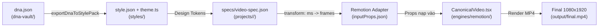

# BÁO CÁO KHẢO SÁT HIỆN TRẠNG HỆ THỐNG AI VIDEO FACTORY V3
> **Thời điểm xuất báo cáo**: 26/10/2026  
> **Mục tiêu**: Chuẩn bị lập kế hoạch (`/plan`) nâng cấp toàn diện: Gỡ bỏ flowkit/vox-director, chuyển đổi cơ chế DNA sang lưu trữ code thuần túy, và tự động phối hợp Skill.

---

## 1. KIỂM TRA DẤU VẾT CỦA FLOWKIT VÀ VOX-DIRECTOR

### 1.1. Trạng thái kiểm tra thư mục
Toàn bộ các thư mục độc lập liên quan đến FlowKit và Vox-Director đã được xóa triệt để khỏi không gian làm việc:
- `[x] .tools/flowkit` — ĐÃ XÓA (Không tồn tại)
- `[x] .agents/skills/flowkit` — ĐÃ XÓA (Không tồn tại)
- `[x] .agents/skills/vox-director` — ĐÃ XÓA (Không tồn tại)
- `[x] projects/vox-style` — ĐÃ XÓA (Không tồn tại)

### 1.2. Kết quả quét mã nguồn trong `core/` và `config/`
Đã quét toàn diện các file chạy chính và cấu hình hệ thống:
- `core/scripts/router/index.js`
- `core/scripts/factory/index.js`
- `core/scripts/factory/services.js`
- `core/scripts/factory/start-services.ps1`
- `core/scripts/factory/doctor.js`
- `core/scripts/factory/state.js`
- `config/factory-config.json`

**Kết luận**: 
- **0 kết quả tồn dư**: Không còn bất kỳ tham chiếu hay lệnh gọi nào tới `flowkit` hoặc `vox`.
- Cổng dịch vụ `:8100` đã được loại bỏ hoàn toàn.
- Hệ thống hiện tại vận hành chuẩn hóa với **1 dịch vụ AI cục bộ duy nhất: CIT Voice Studio (`VieNeu-TTS` local tại port `:8001`)** và **1 engine render duy nhất: Remotion**.

---

## 2. DANH SÁCH & NỘI DUNG 10 SKILL HIỆN CÓ TRONG `.agents/skills/`

Hệ thống hiện duy trì 10 bộ kỹ năng chuyên biệt cho sản xuất video:

### 2.1. Bảng tổng hợp chức năng
| STT | Skill | Nhiệm vụ chính | Đầu vào / Đầu ra | Bước tác động trong Pipeline |
| :--- | :--- | :--- | :--- | :--- |
| 1 | `reels-scripting` | Xây dựng cấu trúc kịch bản video ngắn (Hook 3s, Problem, Solution, Benefits, CTA) tối ưu giữ chân người xem (retention). | • **In**: Ý tưởng, chủ đề hoặc dữ liệu thô.<br>• **Out**: Script kịch bản phân đoạn có timecode và visual direction. | Bước 1: Kịch bản (Scripting) |
| 2 | `humanizer` | Khử văn phong máy móc của AI, loại bỏ thuật ngữ sáo mòn, viết lại câu thoại tự nhiên, ấm áp như văn nói người thật. | • **In**: Bản nháp kịch bản từ LLM.<br>• **Out**: Lời thoại tự nhiên, giàu cảm xúc và nhịp điệu. | Bước 1: Biên tập kịch bản |
| 3 | `prompts-chat` | Thư viện 1.100+ prompt và Role-Playing Personas phục vụ Story Director, chế tác Hook 3s đầu viral và ẩn dụ trực quan. | • **In**: Nhu cầu sáng tạo kịch bản/hook.<br>• **Out**: Persona chuyên gia, visual metaphor độc đáo. | Bước 1: Lên ý tưởng & Hook |
| 4 | `cit-voice-studio` | Sinh giọng đọc AI tiếng Việt chất lượng studio (Hải Đăng 48kHz) và trích xuất timing chính xác từng từ bằng mô hình VieNeu-TTS (:8001). | • **In**: Text lời thoại voiceover.<br>• **Out**: Audio `.wav`/`.mp3` + file timing word-level (.json/.srt). | Bước 2: Audio & Timing |
| 5 | `remotion-explainer` | Thiết kế kiến trúc thị giác Hybrid 3D WebGL (ThreeCanvas/R3F) kết hợp thẻ 2.5D Spatial Glass HUD cho video dọc 9:16. | • **In**: Dữ liệu thẻ, thông số kỹ thuật, style tokens.<br>• **Out**: React component 3D/HUD chuẩn EBU R128. | Bước 2 & 3: Storyboard & Dựng cảnh |
| 6 | `remotion-best-practices`| Đảm bảo chuẩn mực kỹ thuật Remotion: Rules of Hooks, dynamic metadata, asset staging, kiểm soát vòng đời component. | • **In**: Mã nguồn React Remotion.<br>• **Out**: Code sạch, tránh re-render thừa và tràn bộ nhớ. | Bước 3: Lập trình Remotion |
| 7 | `remotion-markup` | Quy chuẩn viết markup JSX/TSX, trigger animation theo frame, spring interpolation, layout an toàn mobile (safe zone). | • **In**: Cấu trúc scene và thẻ dữ liệu.<br>• **Out**: Giao diện thẻ trực quan responsive, không giật lag chữ. | Bước 3: Lập trình Remotion |
| 8 | `motion-ai-kit` | Tính toán công thức vật lý chuyển động (damping, stiffness, mass), hàm `linear()` và kiểm tra điểm chất lượng MotionScore. | • **In**: Yêu cầu nhịp chuyển động (snappy, gentle, bounce).<br>• **Out**: Token cấu hình Spring physics đồng bộ. | Bước 3: Motion Physics |
| 9 | `gsap-skills` | Cung cấp kỹ thuật diễn hoạt phức tạp với GSAP (timelines, stagger, morphing đường cong SVG) cho biểu đồ nâng cao. | • **In**: Yêu cầu diễn hoạt số liệu biểu đồ phức tạp.<br>• **Out**: Script timeline tweening chính xác từng miligiây. | Bước 3: Diễn hoạt biểu đồ |
| 10 | `auto-footage` | Xử lý video quay sẵn (talking-head): tự động jump-cut loại bỏ khoảng lặng, sync phụ đề động và overlay motion graphics. | • **In**: Video thô (`raw.mp4`).<br>• **Out**: Video thành phẩm đã cắt tỉa gọn gàng kèm motion graphics. | Dựng hậu kỳ Video thô |

---

## 3. GIẢI PHẪU MODULE PHÂN TÍCH DNA HIỆN TẠI (`core/scripts/dna/` & `dna-vault/`)

### 3.1. Toàn bộ mã nguồn `core/scripts/dna/index.js` (91 dòng)
```javascript
import fs from "node:fs";
import path from "node:path";
import { fileURLToPath } from "node:url";
import minimist from "minimist";
import { analyzeReferenceVideo } from "./analyze.js";

const ROOT = path.resolve(path.dirname(fileURLToPath(import.meta.url)), "../../..");
const VAULT_DIR = path.join(ROOT, "dna-vault");

export async function main(argv = process.argv.slice(2)) {
  const args = minimist(argv);
  const command = args._[0];

  if (!command || command === "help") {
    console.log(`
🧬 [AI Video Factory] DNA Reverse-Engineering & Cloning Engine

Cách sử dụng:
  npm run dna -- analyze <file-video-mẫu> [--id <ten-id>]
      Bóc tách toàn diện video mẫu: FFprobe specs, isolated audio, 1fps frames, contact sheet, và dna.json.

  npm run dna -- list
      Liệt kê toàn bộ các phong cách video (DNA Profiles) đã bóc tách trong dna-vault/.

  npm run dna -- show <dna-id>
      Xem chi tiết thông số DNA, bảng màu, typography và animation physics.

Ví dụ:
  npm run dna -- analyze "D:\\videos\\mau-tech-review.mp4" --id TECH-EXPLAINER-PRO
`);
    return;
  }

  if (command === "analyze") {
    const videoPath = args._[1] || args.path || args.video;
    if (!videoPath) {
      console.error("❌ Lỗi: Vui lòng cung cấp đường dẫn video mẫu. Ví dụ: npm run dna -- analyze sample.mp4");
      process.exit(1);
    }
    const customId = args.name || args.id;
    await analyzeReferenceVideo(videoPath, customId);
    return;
  }

  if (command === "list") {
    if (!fs.existsSync(VAULT_DIR)) {
      console.log("dna-vault/ trống. Chưa có mẫu DNA nào.");
      return;
    }
    const entries = fs.readdirSync(VAULT_DIR, { withFileTypes: true })
      .filter(d => d.isDirectory() && fs.existsSync(path.join(VAULT_DIR, d.name, "dna.json")));

    console.log(`\n🧬 Danh mục DNA Profiles trong dna-vault (${entries.length} phong cách):\n`);
    for (const ent of entries) {
      try {
        const dna = JSON.parse(fs.readFileSync(path.join(VAULT_DIR, ent.name, "dna.json"), "utf8"));
        console.log(`• [${dna.id}]`);
        console.log(`  └─ Thời lượng: ${dna.mediaSpecs.durationSec}s | Khung hình: ${dna.mediaSpecs.width}x${dna.mediaSpecs.height} (${dna.mediaSpecs.aspectRatio})`);
        console.log(`  └─ Nhịp độ: ${dna.rhythmAndPacing.pacingVelocity} (Cắt mỗi ${dna.rhythmAndPacing.avgCutIntervalSec}s)`);
        console.log(`  └─ Thư mục: dna-vault/${ent.name}/\n`);
      } catch {
        console.log(`• ${ent.name} (Chưa hoàn tất dna.json)`);
      }
    }
    return;
  }

  if (command === "show") {
    const id = args._[1] || args.id;
    if (!id) {
      console.error("Vui lòng cung cấp id DNA.");
      process.exit(1);
    }
    const file = path.join(VAULT_DIR, id, "dna.json");
    if (!fs.existsSync(file)) {
      console.error(`Không tìm thấy profile DNA: ${id}`);
      process.exit(1);
    }
    console.log(fs.readFileSync(file, "utf8"));
    return;
  }

  console.error(`Lệnh không hợp lệ: ${command}. Gõ 'npm run dna' để xem trợ giúp.`);
}

if (process.argv[1] && path.resolve(process.argv[1]) === fileURLToPath(import.meta.url)) {
  main().catch(err => {
    console.error(err);
    process.exit(1);
  });
}
```

---

### 3.2. Toàn bộ mã nguồn `core/scripts/dna/analyze.js` (341 dòng)
```javascript
import fs from "node:fs";
import path from "node:path";
import { spawnSync } from "node:child_process";
import { fileURLToPath } from "node:url";
import { exportDnaToStylePack } from "../style/exporter.js";

const ROOT = path.resolve(path.dirname(fileURLToPath(import.meta.url)), "../../..");

function resolveBinary(name) {
  const exeName = process.platform === "win32" ? `${name}.exe` : name;
  const candidates = [
    path.join(ROOT, ".tools", "ffmpeg", "ffmpeg-9.0.2-full_build", "bin", exeName),
    path.join(ROOT, "engines", "remotion", "node_modules", "@remotion", "compositor-win32-x64-msvc", exeName),
    exeName
  ];
  for (const candidate of candidates) {
    if (candidate === exeName || fs.existsSync(candidate)) {
      try {
        const test = spawnSync(candidate, ["-version"], { encoding: "utf8", timeout: 10000 });
        if (test.status === 0) return candidate;
      } catch {
        // continue
      }
    }
  }
  throw new Error(`Binary ${name} not found`);
}

function runCmd(binaryName, args) {
  const bin = resolveBinary(binaryName);
  const result = spawnSync(bin, args, { encoding: "utf8", maxBuffer: 20 * 1024 * 1024, timeout: 300000 });
  if (result.status !== 0) {
    throw new Error(`${binaryName} failed: ${(result.stderr || result.error?.message || "").slice(-2000)}`);
  }
  return result;
}

export function probeMedia(filePath) {
  if (!fs.existsSync(filePath) || fs.statSync(filePath).size === 0) {
    throw new Error(`Media file not found or empty: ${filePath}`);
  }
  const out = runCmd("ffprobe", [
    "-v", "error",
    "-show_streams",
    "-show_format",
    "-of", "json",
    filePath
  ]).stdout;
  return JSON.parse(out);
}

export async function analyzeReferenceVideo(videoPath, customId) {
  const resolvedVideo = path.resolve(videoPath);
  if (!fs.existsSync(resolvedVideo)) {
    throw new Error(`File does not exist: ${resolvedVideo}`);
  }

  const stat = fs.statSync(resolvedVideo);
  if (stat.size === 0) {
    throw new Error(`File is empty: ${resolvedVideo}`);
  }

  // Generate ID if not provided
  const baseName = path.basename(resolvedVideo, path.extname(resolvedVideo))
    .toLowerCase()
    .replace(/[^a-z0-9_-]/g, "-")
    .replace(/-+/g, "-")
    .slice(0, 35);
  const dateStr = new Date().toISOString().slice(0, 10).replace(/-/g, "");
  const id = customId || `DNA-${dateStr}-${baseName}`;

  const vaultDir = path.join(ROOT, "dna-vault", id);
  const rawDir = path.join(vaultDir, "raw");
  const keyframesDir = path.join(rawDir, "keyframes");
  const scenesDir = path.join(rawDir, "scenes");

  fs.mkdirSync(vaultDir, { recursive: true });
  fs.mkdirSync(keyframesDir, { recursive: true });
  fs.mkdirSync(scenesDir, { recursive: true });

  console.log(`\n🧬 [DNA Cloner] Reverse-Engineering Reference Video: ${baseName}`);
  console.log(`📁 Destination: ${vaultDir}`);

  // 1. Probe technical specifications
  console.log(`🔍 Probing metadata with FFprobe...`);
  const meta = probeMedia(resolvedVideo);
  const vStream = meta.streams.find(s => s.codec_type === "video") || {};
  const aStream = meta.streams.find(s => s.codec_type === "audio") || {};
  const durationSec = Number(meta.format?.duration || vStream.duration || 0);
  const width = vStream.width || 0;
  const height = vStream.height || 0;
  const fpsStr = vStream.r_frame_rate || "30/1";
  const [fpsNum, fpsDen] = fpsStr.split("/").map(Number);
  const fps = fpsDen ? Math.round(fpsNum / fpsDen) : 30;

  console.log(`   Dimensions: ${width}x${height} (${width < height ? "Portrait 9:16" : "Landscape 16:9"})`);
  console.log(`   Duration: ${durationSec.toFixed(2)}s | FPS: ${fps} | Codec: ${vStream.codec_name || "unknown"}`);

  // Copy or symlink original reference video
  const refDest = path.join(rawDir, "reference.mp4");
  if (!fs.existsSync(refDest)) {
    fs.copyFileSync(resolvedVideo, refDest);
  }

  // 2. Extract clean audio
  const audioDest = path.join(rawDir, "narration.wav");
  const audioMp3 = path.join(rawDir, "audio.mp3");
  console.log(`🎙️ Extracting isolated audio track...`);
  try {
    runCmd("ffmpeg", ["-y", "-i", resolvedVideo, "-vn", "-acodec", "pcm_s16le", "-ar", "48000", "-ac", "2", audioDest]);
    runCmd("ffmpeg", ["-y", "-i", resolvedVideo, "-vn", "-c:a", "libmp3lame", "-b:a", "192k", audioMp3]);
  } catch (err) {
    console.warn(`   Audio extraction warning: ${err.message}`);
  }

  // 3. Scene Cut Detection (Extract Keyframe at each cut)
  console.log(`✂️ Detecting scene cuts (visual beats)...`);
  try {
    runCmd("ffmpeg", [
      "-y", "-i", resolvedVideo,
      "-filter_complex", "select='gt(scene,0.25)'",
      "-fps_mode", "vfr",
      "-q:v", "2",
      path.join(scenesDir, "cut_%03d.jpg")
    ]);
  } catch {
    try {
      runCmd("ffmpeg", [
        "-y", "-i", resolvedVideo,
        "-filter_complex", "select='gt(scene,0.25)'",
        "-vsync", "vfr",
        "-q:v", "2",
        path.join(scenesDir, "cut_%03d.jpg")
      ]);
    } catch (err) {
      console.warn(`   Scene detection warning: ${err.message}`);
    }
  }

  // 4. Sample frames at 1 fps (for continuous motion flow)
  console.log(`⏱️ Extracting 1fps timeline samples...`);
  try {
    runCmd("ffmpeg", [
      "-y", "-i", resolvedVideo,
      "-vf", "fps=1,scale=720:-1",
      "-q:v", "3",
      path.join(keyframesDir, "sec_%03d.jpg")
    ]);
  } catch (err) {
    console.warn(`   1fps sampling warning: ${err.message}`);
  }

  // 5. Generate high-density Contact Sheet
  console.log(`🖼️ Building visual contact sheet...`);
  const contactSheetPath = path.join(rawDir, "contact_sheet.jpg");
  try {
    // Generate up to 25 tiles (5x5 grid)
    runCmd("ffmpeg", [
      "-y", "-i", resolvedVideo,
      "-vf", `fps=${Math.max(0.2, (25 / durationSec)).toFixed(3)},scale=270:480,tile=5x5`,
      "-frames:v", "1",
      "-q:v", "2",
      contactSheetPath
    ]);
  } catch (err) {
    console.warn(`   Contact sheet warning: ${err.message}`);
  }

  // Count extracted cuts
  const sceneFiles = fs.existsSync(scenesDir) ? fs.readdirSync(scenesDir).filter(f => f.endsWith(".jpg")) : [];
  const keyframeFiles = fs.existsSync(keyframesDir) ? fs.readdirSync(keyframesDir).filter(f => f.endsWith(".jpg")) : [];

  const avgCutDuration = sceneFiles.length > 0 ? (durationSec / sceneFiles.length).toFixed(1) : durationSec.toFixed(1);

  // 6. Build initial DNA profile
  const dnaProfile = {
    id,
    source: path.basename(resolvedVideo),
    extractedAt: new Date().toISOString(),
    mediaSpecs: {
      width,
      height,
      aspectRatio: width < height ? "9:16" : "16:9",
      durationSec: Number(durationSec.toFixed(2)),
      fps,
      videoCodec: vStream.codec_name || "unknown",
      audioCodec: aStream.codec_name || "unknown",
      sampleRate: aStream.sample_rate || 48000
    },
    rhythmAndPacing: {
      totalSceneCuts: sceneFiles.length,
      avgCutIntervalSec: Number(avgCutDuration),
      pacingVelocity: Number(avgCutDuration) < 2.5 ? "FAST / HIGH ADRENALINE" : Number(avgCutDuration) < 4.5 ? "DYNAMIC EXPLAINER" : "CALM / DOCUMENTARY"
    },
    clonedDnaBlueprint: {
      visualStyle: {
        palette: {
          background: "#0f172a",
          surface: "#1e293b",
          primaryText: "#ffffff",
          accentColor: "#38bdf8",
          secondaryAccent: "#f59e0b"
        },
        cardArchetype: "Hero Metric / Comparison Split",
        cornerRadius: 24,
        borderStyle: "1px solid rgba(255,255,255,0.12)",
        shadow: "0 20px 40px rgba(0,0,0,0.5)"
      },
      typography: {
        headlineFont: "Montserrat / Inter Bold",
        headlineSize: 64,
        bodyFont: "Inter Regular",
        bodySize: 36,
        textCasing: "mixed",
        safeZonePaddingY: [260, 1550]
      },
      subtitleStyle: {
        type: "speech-synced-word-highlight",
        container: "frosted-pill-glassmorphism",
        activeWordColor: "#38bdf8",
        inactiveWordColor: "rgba(255,255,255,0.7)",
        positionY: 1450
      },
      motionPhysics: {
        springConfig: {
          damping: 18,
          stiffness: 140,
          mass: 0.8
        },
        entranceMotion: "slide-up + pop-scale(0.85 -> 1.0)",
        continuousMotion: "subtle-floating(sin-wave +- 6px)",
        transitionStyle: "seamless-morph / quick-cut"
      },
      soundDesign: {
        narrationPacingWpm: 150,
        voiceGender: "male",
        voiceTone: "Authoritative, confident, tech-savvy",
        bgmStyle: "Minimal low-tempo modern lo-fi / electronic pulse",
        sfxCueTypes: ["whoosh-transition", "pop-reveal", "cash-ding", "camera-click"]
      }
    },
    artifacts: {
      contactSheet: path.relative(ROOT, contactSheetPath).replaceAll("\\", "/"),
      audioTrack: path.relative(ROOT, audioMp3).replaceAll("\\", "/"),
      sceneCutsCount: sceneFiles.length,
      keyframesCount: keyframeFiles.length
    }
  };

  const dnaJsonPath = path.join(vaultDir, "dna.json");
  fs.writeFileSync(dnaJsonPath, JSON.stringify(dnaProfile, null, 2) + "\n");

  // 7. Write Markdown Summary
  const readmeContent = `# DNA PROFILE: ${id}

> **Nguồn video mẫu**: \`${path.basename(resolvedVideo)}\`  
> **Thời lượng**: ${durationSec.toFixed(2)}s | **Khung hình**: ${width}x${height} (${width < height ? "9:16 Mobile" : "16:9"}) | **FPS**: ${fps}

---

## 📸 Bức tranh thị giác tổng quan (Contact Sheet)

Toàn bộ nhịp diễn hoạt của video mẫu được trích xuất thành 1 contact sheet tại:
\`${path.relative(vaultDir, contactSheetPath).replaceAll("\\", "/")}\`

---

## 🔬 Giải phẫu 5 tầng DNA của video mẫu

### 1. Nhịp độ & Dựng cảnh (Rhythm & Cuts)
- **Tổng số cảnh (Scene Cuts)**: **${sceneFiles.length}** điểm cắt.
- **Tần suất cắt trung bình**: **${avgCutDuration} giây/cảnh**.
- **Đánh giá nhịp độ**: **${dnaProfile.rhythmAndPacing.pacingVelocity}**.

### 2. Thiết kế Thẻ & Màu sắc (Layout & Color Palette)
- **Nền**: \`${dnaProfile.clonedDnaBlueprint.visualStyle.palette.background}\`
- **Mặt thẻ (Card Surface)**: \`${dnaProfile.clonedDnaBlueprint.visualStyle.palette.surface}\`
- **Màu nhấn (Accent)**: \`${dnaProfile.clonedDnaBlueprint.visualStyle.palette.accentColor}\`
- **Bo góc (Radius)**: \`${dnaProfile.clonedDnaBlueprint.visualStyle.cornerRadius}px\`

### 3. Phụ đề & Typography (Subtitles DNA)
- **Kiểu phụ đề**: Highlight từng từ theo giọng nói thật (Speech-synced word highlight).
- **Màu từ đang đọc**: \`${dnaProfile.clonedDnaBlueprint.subtitleStyle.activeWordColor}\`
- **Vị trí hiển thị an toàn**: Safe zone \`y: ${dnaProfile.clonedDnaBlueprint.subtitleStyle.positionY}\`

### 4. Vật lý chuyển động (Spring Motion DNA)
- **Spring parameters**: \`damping: ${dnaProfile.clonedDnaBlueprint.motionPhysics.springConfig.damping}\`, \`stiffness: ${dnaProfile.clonedDnaBlueprint.motionPhysics.springConfig.stiffness}\`, \`mass: ${dnaProfile.clonedDnaBlueprint.motionPhysics.springConfig.mass}\`.
- **Hiệu ứng xuất hiện**: ${dnaProfile.clonedDnaBlueprint.motionPhysics.entranceMotion}.
- **Hiệu ứng duy trì (Continuous Motion)**: ${dnaProfile.clonedDnaBlueprint.motionPhysics.continuousMotion}.

### 5. Thiết kế Âm thanh (Sound Design DNA)
- **Tốc độ đọc**: ~${dnaProfile.clonedDnaBlueprint.soundDesign.narrationPacingWpm} WPM.
- **Tone giọng**: ${dnaProfile.clonedDnaBlueprint.soundDesign.voiceTone}.
- **SFX điểm xuyết**: ${dnaProfile.clonedDnaBlueprint.soundDesign.sfxCueTypes.join(", ")}.

---

## 🎯 Hướng dẫn nhân bản (100% Replication Guide)

1. Mở xem Contact Sheet để nắm trọn vẹn bố cục các cảnh.
2. Dùng file \`dna.json\` này để áp dụng vào component Remotion tương ứng trong \`engines/remotion/src/projects/\`.
3. Giữ 100% DNA chuyển động và bố cục thẻ, thay thế nội dung kịch bản mới.
`;

  fs.writeFileSync(path.join(vaultDir, "README.md"), readmeContent);

  // 8. Tự động xuất sang thư viện Styles tập trung
  try {
    exportDnaToStylePack(dnaProfile, customId, vaultDir);
  } catch (err) {
    console.warn(`   ⚠️ Style export warning: ${err.message}`);
  }

  console.log(`\n✅ [DNA Cloner] Reverse-Engineering HOÀN TẤT!`);
  console.log(`   └─ DNA JSON: ${dnaJsonPath}`);
  console.log(`   └─ Contact Sheet: ${contactSheetPath}`);
  console.log(`   └─ Audio Bóc tách: ${audioMp3}`);
  console.log(`   └─ Tổng Scene Cuts: ${sceneFiles.length} ảnh`);
  console.log(`   └─ Tổng 1fps Frames: ${keyframeFiles.length} ảnh\n`);

  return dnaProfile;
}

// CLI entrypoint
if (process.argv[1] && path.resolve(process.argv[1]) === fileURLToPath(import.meta.url)) {
  const args = process.argv.slice(2);
  const targetIndex = args.findIndex(a => !a.startsWith("-"));
  if (targetIndex === -1) {
    console.error("Usage: node core/scripts/dna/analyze.js <video-path> [--name <style-name> | --id <custom-id>]");
    process.exit(1);
  }
  const videoPath = args[targetIndex];
  const idIndex = args.indexOf("--id");
  const nameIndex = args.indexOf("--name");
  const customId = nameIndex !== -1 ? args[nameIndex + 1] : (idIndex !== -1 ? args[idIndex + 1] : null);

  analyzeReferenceVideo(videoPath, customId).catch(err => {
    console.error(`❌ DNA Analysis Failed:`, err.message);
    process.exit(1);
  });
}
```

---

### 3.3. Cấu trúc thư mục mẫu trong `dna-vault/`

#### A. Danh sách file trong `dna-vault/HODL-VN-INVESTMENT-RACE/`:
```text
dna-vault/HODL-VN-INVESTMENT-RACE/
├── dna.json                     (1.93 KB — Chứa thông số kỹ thuật, palette, typography, visualComponents)
├── README.md                    (2.14 KB — Báo cáo giải phẫu chi tiết lý do video viral & retention)
├── cloned-preview-chart.png     (197 KB — Ảnh chụp preview biểu đồ)
├── cloned-preview-outro.png     (116 KB — Ảnh chụp preview outro)
└── cloned-preview-table.png     (134 KB — Ảnh chụp preview bảng)
```

*(Đối chiếu với `dna-vault/vinfast-cham-tuong-lai/`: Thư mục này hiện chứa thư mục `raw/` nặng nề bao gồm `narration.wav` 8.58MB, `audio.mp3` 1.07MB, `reference.mp4` 3.27MB, `contact_sheet.jpg` và hàng chục ảnh frame `cut_*.jpg`, `sec_*.jpg`. Đây là nguyên nhân khiến workspace bị phình to và là trọng tâm cải tạo ở Mục tiêu 2).*

#### B. Toàn bộ nội dung `dna-vault/HODL-VN-INVESTMENT-RACE/dna.json`:
```json
{
  "id": "HODL-VN-INVESTMENT-RACE",
  "sourceVideo": "video_2026-10-21_09-36-22.mp4",
  "archetype": "Financial Investment Race Chart / Data Visualization",
  "metadata": {
    "targetDurationSec": 60,
    "sourceDurationSec": 154.62,
    "fps": 30,
    "aspectRatio": "9:16",
    "width": 1080,
    "height": 1920
  },
  "palette": {
    "background": "#0b0e14",
    "surface": "#161b22",
    "gridLine": "rgba(255, 255, 255, 0.08)",
    "textPrimary": "#ffffff",
    "textSecondary": "#94a3b8",
    "goldAccent": "#d4af37",
    "goldPill": "#fef08a",
    "redAlert": "#ef4444",
    "lineColors": {
      "item1": "#38bdf8",
      "item2": "#22c55e",
      "item3": "#c084fc",
      "item4": "#f97316",
      "item5": "#ef4444",
      "benchmark": "#e2e8f0"
    }
  },
  "typography": {
    "fontFamily": "Inter, Montserrat, sans-serif",
    "eyebrow": { "size": 32, "color": "#d4af37", "weight": "600", "tracking": "wider" },
    "headline": { "size": 60, "color": "#ffffff", "weight": "800" },
    "subheadline": { "size": 34, "color": "#94a3b8", "weight": "400" },
    "giantYear": { "size": 130, "color": "#d4af37", "weight": "900" },
    "giantMonth": { "size": 48, "color": "#cbd5e1", "weight": "500" },
    "subtitles": {
      "size": 44,
      "color": "#ffffff",
      "highlightWordColor": "#d4af37",
      "highlightUnderline": true
    }
  },
  "visualComponents": [
    "FixedHeader (Eyebrow + Title + Subtitle)",
    "DynamicSvgLineChart (Multi-node progressive curve rendering)",
    "TrackingBadges (Logo + Value pill that tracks curve heads)",
    "Top1LeaderStar (Golden glow + star icon on current 1st place)",
    "EventMarkers (Vertical dashed lines for Covid, Crash, Flip events)",
    "BottomAnchor (Giant Year + Month ticker + speech-synced subtitle)",
    "SummaryPodiumTable (Rank 1-5 leaderboard table with ROI multipliers)",
    "OutroBrandingCard (Infinity logo + Slogan + Legal disclaimer)"
  ]
}
```

#### C. Toàn bộ nội dung `dna-vault/HODL-VN-INVESTMENT-RACE/README.md`:
```markdown
# BÁO CÁO GIẢI PHẪU DNA: HODL.VN INVESTMENT RACE CHART 🧬

> **Video nguồn**: `video_2026-10-21_09-36-22.mp4` (Kênh HODL.VN)  
> **Định dạng**: Vertical 9:16 Mobile | **Chủ đề**: So sánh đầu tư 100 triệu vào 5 cổ phiếu ngân hàng vs Gửi tiết kiệm qua các năm (2019 - 2026).

---

## 🏆 Tại sao video này cực kỳ cuốn hút (Retention Secrets)?

1. **Format "Race Chart" gây nghiện**: Não bộ con người bị thôi miên bởi các cuộc đua tài sản tăng/giảm liên tục và tò mò ai sẽ là người chiến thắng ở đích đến.
2. **Visual Hierarchy hoàn hảo**:
   - 1/4 trên: Header cố định giữ ngữ cảnh (`100 triệu VN30 - Mua ngày 02/01/2019, giữ tới nay`). Người xem lướt vào giữa chừng vẫn hiểu ngay.
   - 1/2 giữa: Biểu đồ đường phát sáng trên nền đen sâu (`#0b0e14`), các huy hiệu ngân hàng di chuyển theo thời gian thực.
   - 1/4 dưới: **Chỉ báo năm khổng lồ** (`2020 tháng 03`) kết hợp phụ đề đồng bộ giọng nói có highlight từ khóa màu vàng kim.
3. **Hiệu ứng kịch tính (Dramatization)**:
   - Các cột mốc lịch sử thực tế (`: Covid`, `: Sập 2022`, `: Đổi ngôi`) gắn trực tiếp trên biểu đồ.
   - Trục Y tự động mở rộng theo cấp số nhân (từ `150 tr` vọt lên `600 tr` rồi `1,60 tỷ`).
   - Bảng tổng kết Leaderboard vinh danh top 1 với hệ số nhân `x13.9` lần tài sản.

---

## 🎨 Design Tokens bóc tách 100%

| Thành phần | Thông số bóc tách |
| :--- | :--- |
| **Nền (Background)** | `#0b0e14` (Obsidian Dark) |
| **Màu vàng kim (Accent Gold)** | `#d4af37` (Dùng cho Eyebrow, Mốc năm, Pill Top 1, Highlight sub) |
| **Màu lưới tọa độ** | `rgba(255, 255, 255, 0.08)` |
| **Font chính** | `Inter / Montserrat`, chữ hoa có tracking rộng cho Eyebrow |
| **Subtitle Style** | Highlight vàng kim kèm gạch chân (`border-b-2 border-yellow-400`) |
| **Badge Top 1** | Viền vàng phát sáng + icon ngôi sao ⭐ + pill nền vàng chữ đen |
```

---

## 4. LIÊN KẾT GIỮA `dna-vault/`, `styles/` VÀ `engines/remotion/`

### 4.1. Toàn bộ nội dung `styles/types.ts` (96 dòng)
```typescript
export interface StyleMeta {
  id: string;
  version: string;
  name: string;
  purpose: string;
  category: "finance" | "tech" | "insurance" | "social" | "editorial" | "kinetic" | "whiteboard" | "map" | "showcase" | "custom";
  bestFor: string[];
  notIdealFor: string[];
  tags: string[];
  sourceDna?: string;
  previewImage?: string;
}

export interface ColorPalette {
  background: string;
  backgroundGradient?: string;
  surface: string;
  surfaceGlass: string;
  border: string;
  borderActive?: string;
  textPrimary: string;
  textSecondary: string;
  textMuted: string;
  accentPrimary: string;
  accentSecondary: string;
  positive: string;
  negative: string;
  warning: string;
}

export interface TextStyleSpec {
  fontSize: number;
  fontWeight: number | string;
  lineHeight?: number;
  letterSpacing?: string;
  textTransform?: "uppercase" | "none" | "capitalize" | "lowercase";
}

export interface TypographyScale {
  fontFamily: string;
  monoFontFamily?: string;
  headline: TextStyleSpec;
  subheadline: TextStyleSpec;
  cardTitle: TextStyleSpec;
  cardBody: TextStyleSpec;
  metricNumber: TextStyleSpec;
  badgeText: TextStyleSpec;
  caption: TextStyleSpec;
}

export interface SubtitleStyle {
  positionY: number; // e.g., 1450 - 1650
  activeWordColor: string;
  inactiveWordColor: string;
  backgroundColor: string;
  borderRadius: number;
  padding: string;
  fontSize: number;
  fontWeight: number | string;
  glow?: string;
}

export interface SpringConfig {
  damping: number;
  stiffness: number;
  mass: number;
}

export interface SpringConfigs {
  snappy: SpringConfig;
  gentle: SpringConfig;
  bounce: SpringConfig;
  slow: SpringConfig;
}

export interface MotionSpecs {
  pacingVelocity: "FAST / HIGH ADRENALINE" | "DYNAMIC EXPLAINER" | "CALM / DOCUMENTARY";
  avgCutIntervalSec: number;
  targetWpm: number;
  entranceMotion: string;
  continuousMotion: string;
}

export interface StyleTheme {
  meta: StyleMeta;
  colors: ColorPalette;
  typography: TypographyScale;
  subtitles: SubtitleStyle;
  springs: SpringConfigs;
  motion: MotionSpecs;
  safeZone: {
    top: number;
    bottom: number;
    paddingX: number;
  };
}
```

---

### 4.2. Toàn bộ nội dung `styles/finance-data-pro/style.json` (69 dòng)
```json
{
  "$schema": "../../schemas/style.schema.json",
  "id": "finance-data-pro",
  "version": "2.0.0",
  "name": "Finance Data Pro",
  "purpose": "Phong cách tài chính & dữ liệu đầu tư chuyên sâu: Tích hợp Bar Chart Race chuẩn HODL.VN, nến TradingView và báo cáo vĩ mô",
  "bestFor": [
    "So sánh lãi suất kép & Đua tài sản qua các năm (Chuẩn DNA HODL)",
    "Phân tích cổ phiếu, VN-Index & Kỹ thuật nến TradingView",
    "Báo cáo vĩ mô, tháp tài sản, lạm phát & tiền tệ",
    "Crypto, vàng, bất động sản & bảng xếp hạng Leaderboard"
  ],
  "notIdealFor": ["Vlog đời sống", "Kể chuyện thiếu nhi"],
  "beatSeconds": {
    "min": 2.0,
    "max": 4.5,
    "resetEveryBeats": 3
  },
  "script": {
    "hookStyle": "Nghịch lý lợi nhuận / Thách thức kết quả cuộc đua tài sản",
    "tone": "Chuyên gia tài chính sắc bén, kịch tính, số liệu định lượng rõ ràng",
    "structure": "Hook số liệu/cuộc đua -> Bối cảnh thị trường -> Diễn biến biểu đồ/nến -> Đột phá lợi nhuận -> Leaderboard Outro"
  },
  "visual": {
    "palette": {
      "background": "#0B0E14",
      "surface": "#121824",
      "accentPrimary": "#D4AF37",
      "accentSecondary": "#38BDF8",
      "positive": "#10B981",
      "negative": "#EF4444"
    },
    "cardStyle": "Obsidian dark glass with gold/cyan neon border highlight and dynamic leaderboard ranks",
    "cornerRadius": 20
  },
  "imagePrompt": {
    "stylePrefix": "obsidian high-tech financial terminal, glowing gold and cyan line charts, cinematic trading screens",
    "negativePrompt": "low quality, blurry, bright pastel cartoon, messy desk"
  },
  "motion": {
    "spring": { "damping": 13, "stiffness": 155, "mass": 0.6 },
    "entrance": "slide-horizontal-expand + pop-scale",
    "targetWpm": 156
  },
  "typography": {
    "headlineFont": "Barlow Condensed Black",
    "bodyFont": "Be Vietnam Pro Bold",
    "monoFont": "JetBrains Mono Bold",
    "safeZoneY": [240, 1540]
  },
  "audio": {
    "voiceGender": "male",
    "tone": "Hải Đăng studio, nam trầm, dứt khoát, hào hứng theo nhịp nhảy số",
    "bgm": "Deep synthwave / upbeat electronic sports tech beat",
    "targetLufs": -12.5
  },
  "thumbnail": {
    "style": "Side-by-side asset race clash with gold crown, giant multiplier number (x5, x10) and TradingView spike"
  },
  "renderer": {
    "primary": "remotion",
    "composition": "InvestmentRaceVideo"
  },
  "prohibited": [
    "Khung hình rỗng",
    "Cắt chữ bằng ellipsis",
    "Số liệu nhảy không theo quán tính mượt mà"
  ]
}
```

---

### 4.3. Cơ chế kết nối giữa `styles/`, `video-spec.json` và Remotion Engine

Quy trình dữ liệu từ khâu phân tích DNA đến video thành phẩm được thực thi qua 4 giai đoạn khép kín:



1. **Giai đoạn 1: Đóng gói Style (`exportDnaToStylePack`)**:
   Khi module phân tích DNA hoạt động, `core/scripts/dna/analyze.js` gọi `exportDnaToStylePack` để trích xuất design tokens (bảng màu HEX, font family, spring parameters, safe zone Y) từ `dna.json` và ghi vào `styles/<style-id>/style.json` kèm `theme.ts` (tuân thủ chặt chẽ interface `StyleTheme` trong `styles/types.ts`).

2. **Giai đoạn 2: Đặc tả dự án (`video-spec.json`)**:
   Mỗi video mới được định nghĩa tại `projects/<id>/specs/video-spec.json`, bao gồm:
   - Tham chiếu phong cách: `"style": "finance-data-pro"`.
   - Cấu trúc kịch bản: `script.scenes` gồm thời lượng mili-giây (`durationMs`), thời điểm bắt đầu (`startMs`).
   - Âm thanh và lời thoại: `narration`, kèm mảng căn thời gian từng từ `timing.words`.

3. **Giai đoạn 3: Chuyển đổi sang Engine (`engines/remotion/adapter/index.js`)**:
   - Hàm `transform(spec, fps=30)` tự động quy đổi thời gian thực từ mili-giây sang frame hình Remotion:
     `durationFrames = Math.ceil((durationMs / 1000) * 30)`
   - Chuẩn bị file đệm `inputProps.json` chứa toàn bộ spec đã tính toán thời gian và copy tài nguyên media vào staging runtime.

4. **Giai đoạn 4: Dựng hình động độc lập (`CanonicalVideo`)**:
   - `engines/remotion/src/Root.tsx` chỉ đăng ký duy nhất Composition động `CanonicalVideo` nhận `props.spec`.
   - Component `CanonicalVideo` sử dụng `<Sequence>` cho từng scene, tự động gắn kết các component dùng chung từ `engines/remotion/src/shared/` (`SceneWrapper`, `SpatialHUDCard`, `Stage3DWrapper`) theo các token trong spec.
   - Adapter kích hoạt Remotion CLI render trực tiếp video Final MP4:
     ```bash
     npx remotion render src/index.ts CanonicalVideo "<project>/output/final.mp4" --props="<path>/inputProps.json" --port=0 --muted
     ```
