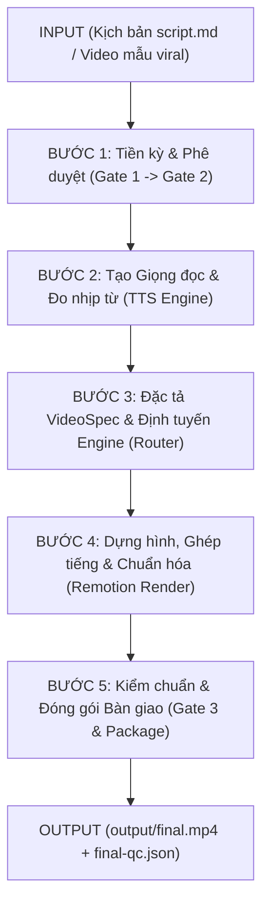

# BÁO CÁO TỔNG HỢP HIỆN TRẠNG TOÀN BỘ DỰ ÁN AI VIDEO FACTORY V3
*Tài liệu phục vụ Chuyên gia Tái cấu trúc & Module hóa Hệ thống*

---

## 1. Cấu trúc cây thư mục (Project Tree)

> **Bộ lọc loại trừ:** Đã loại trừ hoàn toàn môi trường ảo (`venv`, `.venv`), thư viện phụ thuộc (`node_modules`), quản lý mã nguồn (`.git`), bộ nhớ đệm (`__pycache__`, `.pytest_cache`, `.cache`, `.runtime`), và các thư mục chứa file media nháp/xuất ra (`output`, `temp`, `exports`, `dist`, `build`).
> **Độ sâu quét:** 3–4 cấp thư mục.

```text
ai-video-factory/ (root: d:/AI/VIDEO AI)
├── .agents/                               # Bộ công cụ Agent Skills và Subagent Teamwork
│   ├── skills/
│   │   ├── auto-footage/                  # Jump-cut & overlay tự động cho raw talking-head
│   │   │   └── SKILL.md
│   │   ├── cit-voice-studio/              # Bridge kết nối VieNeu-TTS AI local (:8001)
│   │   │   ├── scripts/
│   │   │   └── SKILL.md
│   │   ├── flowkit/                       # Tự động hóa Google Flow (Omni 1.1 / Veo)
│   │   │   └── SKILL.md
│   │   ├── gsap-skills/                   # Tham chiếu GSAP animation engine
│   │   │   └── SKILL.md
│   │   ├── humanizer/                     # Bộ lọc khử văn phong máy móc AI
│   │   ├── motion-ai-kit/                 # Thư viện hiệu ứng CSS / Motion Framer
│   │   ├── prompts-chat/                  # Kho 1.100+ system prompts
│   │   ├── reels-scripting/               # Kỹ thuật kịch bản ngắn giữ chân người xem
│   │   ├── remotion-best-practices/       # Bộ cẩm nang tối ưu hóa Remotion
│   │   ├── remotion-explainer/            # Thiết kế 3D WebGL ThreeCanvas + Spatial HUD
│   │   ├── remotion-markup/               # Hướng dẫn cấu trúc animation Remotion
│   │   └── vox-director/                  # Agent tạo video paper-collage kiểu Vox
│   │       ├── package.json
│   │       └── SKILL.md
│   └── teamwork/                          # Thư mục lưu nhật ký & mã thử nghiệm của subagents
├── .archive/                              # Lưu trữ phiên bản cũ (Legacy / Backup)
│   ├── .audit-remotion-cuongit-template/
│   ├── legacy-v2-pre-rebuild/             # Mã nguồn Factory V2 cũ (kèm OpenCV và venv cũ)
│   ├── _backup-before-video-factory-v2-20260922-113502/
│   └── _gen-video-legacy/
├── .tools/                                # Công cụ binary độc lập phục vụ render
│   ├── ffmpeg/                            # Bản dựng FFmpeg Windows x64 (ffmpeg, ffplay, ffprobe)
│   │   └── ffmpeg-9.0.2-full_build/
│   │       └── bin/
│   └── flowkit/                           # Backend FastAPI & Chrome Extension Google Flow
│       ├── agent/                         # Server điều khiển FastAPI (:8100)
│       │   ├── api/                       # REST endpoints (scenes, flow, tts, projects...)
│       │   ├── db/                        # SQLite persistence & migrations
│       │   ├── services/                  # WebSocket event bus & flow client
│       │   ├── worker/                    # Task queue & processor
│       │   └── main.py                    # Entry point chính của FlowKit Backend
│       ├── extension/                     # Chrome Extension MV3 kết nối flow.google.com
│       ├── requirements.txt
│       ├── requirements-dev.txt
│       ├── setup.sh
│       └── start-flowkit.ps1
├── assets/                                # Tài nguyên âm thanh/hình ảnh mẫu dùng chung
│   ├── audio/                             # Nhạc nền BGM, SFX giao diện (whoosh, click, pop)
│   ├── fonts/
│   └── images/
├── brand/                                 # Cấu hình nhận diện thương hiệu (Brand Isolation)
│   ├── manulife/                          # Preset mẫu doanh nghiệp (logo, brand kit)
│   └── user-brand.json                    # Cấu hình thương hiệu User bắt buộc (Watermark, CTA)
├── config/                                # Cấu hình lõi của Factory
│   ├── component-index.json               # Chỉ mục metadata các linh kiện visual
│   ├── factory-config.json                # Cấu hình engine chính (Remotion) và cổng dịch vụ
│   └── gen-video.json
├── core/                                  # TẦNG ĐIỀU PHỐI TRUNG TÂM (Factory Orchestrator)
│   ├── contracts/                         # Hợp đồng giao diện chuẩn giữa các engine
│   │   ├── capabilities.js                # Định nghĩa năng lực đồ họa của từng engine
│   │   └── engine.ts                      # Interface IVideoEngine chuẩn hóa
│   ├── engines/                           # Thư mục chứa runtime đệm của engine
│   │   └── remotion/
│   ├── package.json                       # Quản lý thư viện riêng của Core Orchestrator
│   ├── package-lock.json
│   ├── schemas/                           # Zod validation schema cho toàn bộ pipeline
│   │   ├── registry.js                    # Đăng ký visual & motion intents
│   │   ├── types.ts                       # Khai báo TypeScript types cho VideoSpec
│   │   └── zod.js                         # Bộ parser Zod kiểm tra tính hợp lệ của Spec
│   ├── scripts/                           # Bộ kịch bản điều khiển CLI của Factory
│   │   ├── dna/                           # CLI bóc tách DNA video viral (analyze, list, show)
│   │   │   ├── analyze.js
│   │   │   └── index.js
│   │   ├── factory/                       # Bộ não điều phối Stage Gates (Gate 1 -> Gate 3)
│   │   │   ├── doctor.js                  # Kiểm tra sức khỏe hệ thống (TTS, Remotion, FFmpeg)
│   │   │   ├── index.js                   # CLI chính của `npm run factory`
│   │   │   ├── media.js                   # Xử lý FFmpeg, inspect audio, loudness EBU R128
│   │   │   ├── package.js                 # Trích xuất 3 thumbnails, metadata SEO và caption
│   │   │   ├── services.js                # Khởi động / Health-check background services
│   │   │   ├── start-services.ps1         # Script kích hoạt CIT Voice Studio & FlowKit
│   │   │   └── state.js                   # State machine quản lý 16 stages & hash input/output
│   │   ├── prompts/                       # Quản lý kho prompt kịch bản
│   │   │   └── index.js
│   │   ├── render/                        # Bộ điều hợp kết xuất video & mux audio
│   │   │   └── index.js
│   │   ├── router/                        # Định tuyến thông minh giữa Remotion & FlowKit
│   │   │   └── index.js
│   │   ├── state/                         # Quản lý fingerprint chữ ký chống build thừa
│   │   │   ├── fingerprint.cjs
│   │   │   └── index.cjs
│   │   ├── style/                         # CLI quản lý Style Packs (list, show, create)
│   │   │   ├── exporter.js
│   │   │   └── index.js
│   │   ├── subtitles/                     # (Thư mục trống mồ côi)
│   │   ├── timing/                        # (Thư mục trống mồ côi)
│   │   ├── tts/                           # Engine sinh voice & trích xuất timing word thật
│   │   │   └── index.js
│   │   └── validate/                      # Kiểm tra tính hợp lệ của video-spec.json
│   │       └── index.js
│   ├── tests/                             # Unit tests của Orchestrator
│   │   └── factory.test.js
│   └── timing/                            # Tính toán thời lượng timeline mili-giây
│       └── index.js
├── dna-vault/                             # Kho lưu trữ DNA bóc tách từ video mẫu thực tế
│   ├── ai-tech-briefing/
│   ├── HODL-VN-INVESTMENT-RACE/           # DNA Bar Chart Race tài chính từ video mẫu viral
│   ├── HUD-DEV-TIMELINE-20REPO/           # DNA 2.5D Spatial Glass HUD lập trình
│   ├── PRO-SAMPLE-01/
│   ├── README.md
│   └── vinfast-cham-tuong-lai/            # DNA Kinetic typography nhịp độ cao
├── engines/                               # CÁC ENGINE DỰNG HÌNH THỰC TẾ
│   └── remotion/                          # Remotion Engine hợp nhất (React + WebGL Three.js)
│       ├── .agents/ & .claude/            # Cấu hình kỹ năng cho trợ lý
│       ├── adapter/                       # Adapter kết nối giữa Core Orchestrator và Remotion
│       │   └── index.js                   # Chuyển đổi Spec sang Frames, staging assets & render
│       ├── assets/                        # Ảnh preview/demo giao diện studio
│       ├── package.json                   # Danh mục thư viện đồ họa (Three.js, Tailwind v4...)
│       ├── package-lock.json
│       ├── public/                        # Thư mục public assets tĩnh phục vụ render
│       │   └── assets/                    # Thư mục chứa hình ảnh dự án (VinFast, Manulife...)
│       ├── remotion.config.ts             # Cấu hình Webpack, concurrency, codec, caching
│       ├── scripts/                       # Scripts hỗ trợ test TTS cục bộ
│       │   └── generate-tts.ts
│       ├── src/                           # Mã nguồn React Component
│       │   ├── CanonicalVideo/            # Cấu trúc video chuẩn hóa dùng chung
│       │   ├── examples/                  # Các ví dụ mẫu chuyển động
│       │   ├── fonts/                     # Khai báo font chữ nhúng
│       │   ├── projects/                  # 24 dự án video Remotion đang bị gộp cứng tại đây
│       │   │   ├── ba-ngan-tien/
│       │   │   ├── bao-hiem-giu-gon/
│       │   │   ├── investment-race-chart/
│       │   │   ├── ung-thu-dai-truc-trang-top-3/
│       │   │   ├── vinfast-kinetic/
│       │   │   └── vnindex-bull-trap/ ...
│       │   ├── shared/                    # Thư viện component tái sử dụng cao cấp
│       │   │   ├── CardArchetypes.tsx     # 6 kiến trúc thẻ chuẩn (Hero, Compare, Grid...)
│       │   │   ├── design-system.tsx      # Hệ thống màu sắc, typography và safe-zone
│       │   │   ├── primitives.tsx         # Badge, IconBox, HighlightedText, ProgressBar
│       │   │   ├── SpatialHUDCard.tsx     # Thẻ 2.5D Glass HUD nghiêng thị sai + laser quét
│       │   │   ├── SpeechSyncedSubtitles.tsx # Phụ đề đồng bộ từng từ theo voice thật
│       │   │   ├── three/                 # 3D WebGL Canvas (<ThreeCanvas>, Shaders)
│       │   │   └── UserBrandOutro.tsx     # Outro thương hiệu bắt buộc chống lộ Brand mẫu
│       │   ├── index.css                  # Tailwind CSS v4 styling
│       │   ├── index.ts                   # Root entry point đăng ký Remotion Root
│       │   └── Root.tsx                   # Khai báo Composition và schema Props
│       └── tsconfig.json
├── fonts/                                 # Font chữ tùy biến cục bộ (.ttf, .otf)
├── learning/                              # Tài liệu đúc kết kiến thức sản xuất video
├── projects/                              # CÁC DỰ ÁN VIDEO SẢN XUẤT THỰC TẾ
│   ├── auto-cuts/                         # Dự án dựng tự động từ video quay sẵn
│   ├── explainers/                        # Video giải thích thẻ 2D chuẩn
│   ├── financial-insurance/               # Video tài chính, bảo hiểm chuyên sâu
│   │   ├── CNT-20260906-UNG-THU-PHOI-PHAT-HIEN-MUON/
│   │   ├── CNT-20260922-NHA-2-5-TY-VAY-1-3-TY/
│   │   ├── CNT-20261023-BAO-HIEM-GIU-GON/
│   │   └── CNT-20261025-UNG-THU-DAI-TRUC-TRANG-TOP-3/ ...
│   ├── motion-graphics/                   # Video đồ họa chuyển động phức tạp
│   ├── social-shorts/                     # Shorts/Reels/TikTok 9:16 dọc
│   └── vox-style/                         # Video phong cách cắt dán báo chí Vox
├── prompts/                               # Bộ thư viện prompt kịch bản và phân rã visual
│   ├── beats-prompts/
│   ├── creative-prompts/
│   └── script-prompts/
├── renders/                               # Thư mục lưu các video Final đã xuất xưởng (.mp4)
├── rules/                                 # Bộ quy tắc nghiêm ngặt về chất lượng thị giác
│   ├── card-archetypes.md                 # 6 mẫu bố cục thẻ bắt buộc tuân thủ
│   └── visual-storytelling.md             # Quy tắc safe zone dọc (360x640), chống cắt chữ
├── schemas/                               # JSON Schemas độc lập cho contracts
│   ├── beats.schema.json
│   ├── blueprint.schema.json
│   ├── motion-spec.schema.json
│   ├── production.schema.json
│   ├── project.schema.json
│   └── style.schema.json
├── scratch/                               # Vùng chứa file nháp, test tạm thời (cần dọn dẹp)
├── scripts/                               # Tiện ích chạy nhanh cấp root
│   ├── gather_blueprint.py                # Gom ngữ cảnh dự án vào blueprint
│   └── start-studio.ps1                   # Khởi chạy Remotion Studio giao diện web
├── styles/                                # BỘ THƯ VIỆN STYLE PACKS TẬP TRUNG
│   ├── ai-tech-briefing/                  # Style công nghệ, tin tức AI
│   ├── clean-explainer/                   # Style giải thích tối giản 2D
│   ├── editorial-news-canvas/             # Style báo chí phóng sự cao cấp
│   ├── finance-data-pro/                  # Style tài chính, Bar Chart Race HODL.VN
│   ├── geopolitical-map-pro/              # Style bản đồ địa chính trị
│   ├── kinetic-minimalist/                # Style typography chữ lớn động lực cao
│   ├── medical-biometrics-pro/            # Style Y sinh học 3D WebGL Three.js
│   ├── multi-asset-trading/               # Style bảng giá nến chứng khoán / crypto
│   ├── showcase-affiliate-luxury/         # Style review sản phẩm sang trọng
│   ├── whiteboard-hand-draw/              # Style vẽ tay bảng trắng
│   ├── index.ts                           # Module export chung của `@styles`
│   ├── registry.json                      # Danh mục đăng ký metadata toàn bộ các styles
│   └── types.ts                           # Interface TypeScript cho Style Definitions
├── templates/                             # Dự án mẫu Remotion độc lập
│   └── cuongit-explainer/                 # Template Remotion độc lập tham chiếu
├── tests/                                 # Bộ kiểm thử End-to-End toàn diện
│   └── e2e/
│       ├── test_final_video.cjs           # Bộ kiểm tra 4-Tier test kiểm chuẩn file MP4
│       └── test_final_video.py
├── .gitignore
├── AGENTS.md                              # Hiến chương hoạt động & Hướng dẫn toàn diện của Factory
├── package.json                           # Root package.json điều phối npm scripts
├── package-lock.json
├── README.md
├── start-services.bat                     # File Batch 1-click kích hoạt toàn bộ services
├── SYSTEM_ARCHITECTURE_REPORT.md          # Báo cáo kiến trúc hệ thống
└── user-brand.json                        # Cấu hình thương hiệu User ở cấp root
```

---

## 2. File quản lý thư viện & môi trường (Dependencies)

Hệ thống có cấu trúc quản lý phụ thuộc đa tầng (Multi-package / Monorepo lai):

### 2.1. [package.json](file:///d:/AI/VIDEO%20AI/package.json) (Root Workspace)
```json
{
  "name": "ai-video-factory",
  "version": "3.0.0",
  "description": "AI Video Factory V3 — Streamlined Social Video Production Workspace",
  "private": true,
  "type": "module",
  "scripts": {
    "doctor": "node core/scripts/factory/index.js doctor",
    "studio": "powershell -ExecutionPolicy Bypass -File .\\scripts\\start-studio.ps1",
    "services": "powershell -ExecutionPolicy Bypass -File .\\core\\scripts\\factory\\start-services.ps1",
    "factory": "node core/scripts/factory/index.js",
    "style": "node core/scripts/style/index.js",
    "dna": "node core/scripts/dna/index.js",
    "prompts": "node core/scripts/prompts/index.js",
    "verify": "node tests/e2e/test_final_video.cjs",
    "test": "npm test --prefix core",
    "lint": "npm run lint --prefix engines/remotion",
    "typecheck": "npm --prefix engines/remotion run typecheck"
  },
  "keywords": [
    "remotion",
    "video-factory",
    "social-video",
    "cit-voice-studio"
  ],
  "author": "",
  "license": "ISC",
  "dependencies": {
    "@remotion/three": "^4.0.519"
  }
}
```

---

### 2.2. [core/package.json](file:///d:/AI/VIDEO%20AI/core/package.json) (Core Orchestrator)
```json
{
  "name": "core",
  "version": "3.0.0",
  "description": "AI Video Factory V3 Core Orchestrator",
  "main": "index.js",
  "scripts": {
    "test": "node --test tests/*.test.js",
    "factory": "node scripts/factory/index.js",
    "video:tts": "node scripts/tts/index.js",
    "video:validate": "node scripts/validate/index.js",
    "video:render": "node scripts/render/index.js"
  },
  "keywords": [],
  "author": "",
  "license": "ISC",
  "type": "module",
  "dependencies": {
    "edge-tts-universal": "^1.4.0",
    "minimist": "^1.2.8",
    "zod": "^4.6.5"
  }
}
```

---

### 2.3. [engines/remotion/package.json](file:///d:/AI/VIDEO%20AI/engines/remotion/package.json) (Remotion Graphic Engine)
```json
{
  "name": "engines-remotion",
  "version": "3.0.0",
  "description": "Unified Remotion Engine for AI Video Factory V3",
  "repository": {},
  "license": "UNLICENSED",
  "private": true,
  "type": "module",
  "dependencies": {
    "@motion-canvas/2d": "^3.17.2",
    "@motion-canvas/core": "^3.17.2",
    "@react-three/drei": "^10.7.9",
    "@react-three/fiber": "^9.8.2",
    "@react-three/postprocessing": "^3.2.2",
    "@react-three/rapier": "^2.2.0",
    "@remotion/captions": "4.0.519",
    "@remotion/cli": "4.0.519",
    "@remotion/fonts": "4.0.519",
    "@remotion/media": "4.0.519",
    "@remotion/tailwind-v4": "4.0.519",
    "@remotion/three": "4.0.519",
    "@remotion/transitions": "4.0.519",
    "@remotion/zod-types": "4.0.519",
    "@rive-app/react-canvas": "^4.37.1",
    "@types/animejs": "^3.1.13",
    "@types/howler": "^2.2.13",
    "@types/three": "^0.186.0",
    "animejs": "^4.5.0",
    "dotenv": "^17.4.2",
    "edge-tts-universal": "^1.4.0",
    "gsap": "^3.15.0",
    "howler": "^2.2.4",
    "lottie-react": "^3.1.2",
    "mediabunny": "^1.62.1",
    "motion": "^14.6.0",
    "react": "19.2.3",
    "react-dom": "19.2.3",
    "remotion": "4.0.519",
    "satori": "^0.63.2",
    "svgo": "^4.1.0",
    "tailwindcss": "4.0.0",
    "three": "^0.186.1",
    "zod": "4.4.3"
  },
  "devDependencies": {
    "@remotion/eslint-config-flat": "4.0.519",
    "@types/react": "19.2.7",
    "@types/web": "0.0.166",
    "eslint": "9.19.0",
    "prettier": "3.8.1",
    "tsx": "^4.23.13",
    "typescript": "5.9.3"
  },
  "scripts": {
    "dev": "remotion studio",
    "build": "remotion bundle",
    "upgrade": "remotion upgrade",
    "lint": "eslint src && tsc",
    "typecheck": "tsc --noEmit",
    "tts": "tsx scripts/generate-tts.ts"
  },
  "sideEffects": [
    "*.css"
  ]
}
```

---

### 2.4. [.tools/flowkit/requirements.txt](file:///d:/AI/VIDEO%20AI/.tools/flowkit/requirements.txt) & [requirements-dev.txt](file:///d:/AI/VIDEO%20AI/.tools/flowkit/requirements-dev.txt) (FlowKit Backend)
```text
fastapi>=0.104.0
uvicorn>=0.24.0
aiosqlite>=0.19.0
websockets>=12.0
pydantic>=2.5.0
aiohttp>=3.9.0
httpx>=0.25.0
anthropic>=0.40.0
python-multipart>=0.0.9
```
*requirements-dev.txt:*
```text
pytest>=8.0.0
pytest-asyncio>=0.23.0
pytest-mock>=3.12.0
```

---

### 2.5. [templates/cuongit-explainer/package.json](file:///d:/AI/VIDEO%20AI/templates/cuongit-explainer/package.json)
```json
{
  "name": "my-video",
  "version": "1.0.0",
  "description": "My Remotion video",
  "repository": {},
  "license": "UNLICENSED",
  "private": true,
  "dependencies": {
    "@remotion/cli": "4.0.407",
    "@remotion/tailwind-v4": "4.0.407",
    "@remotion/zod-types": "4.0.407",
    "dotenv": "^17.4.2",
    "edge-tts-universal": "^1.4.0",
    "react": "19.2.3",
    "react-dom": "19.2.3",
    "remotion": "4.0.407",
    "tailwindcss": "4.0.0",
    "zod": "3.22.3"
  },
  "devDependencies": {
    "@remotion/eslint-config-flat": "4.0.407",
    "@types/react": "19.2.7",
    "@types/web": "0.0.166",
    "eslint": "9.19.0",
    "prettier": "3.6.0",
    "tsx": "^4.23.13",
    "typescript": "5.9.3"
  },
  "scripts": {
    "dev": "remotion studio",
    "build": "remotion bundle",
    "upgrade": "remotion upgrade",
    "lint": "eslint src && tsc",
    "tts": "tsx scripts/generate-tts.ts"
  },
  "sideEffects": [
    "*.css"
  ]
}
```

---

## 3. Mã nguồn các file chạy chính (Entry Points)

### 3.1. [start-services.bat](file:///d:/AI/VIDEO%20AI/start-services.bat) (10 dòng — Toàn bộ mã nguồn)
Kịch bản Windows Batch kích hoạt 1-click các background service.
```bat
@echo off
chcp 65001 > nul
title AI Video Factory — Khởi động Services
echo ==================================================
echo   AI VIDEO FACTORY V3 — KHỞI ĐỘNG CÁC DỊCH VỤ
echo ==================================================
echo.
powershell -NoProfile -ExecutionPolicy Bypass -File "%~dp0core\scripts\factory\start-services.ps1"
echo.
pause
```

---

### 3.2. [scripts/start-studio.ps1](file:///d:/AI/VIDEO%20AI/scripts/start-studio.ps1) (14 dòng — Toàn bộ mã nguồn)
Khởi động giao diện Web Remotion Studio để xem trước các cảnh quay.
```powershell
$ErrorActionPreference = "Stop"

$Root = Split-Path -Parent (Split-Path -Parent $MyInvocation.MyCommand.Path)
$Project = Join-Path $Root "engines\remotion"

if (-not (Test-Path $Project)) {
    Write-Host "Khong tim thay Remotion engine: $Project" -ForegroundColor Red
    Write-Host "Hay chay bootstrap.ps1 truoc."
    exit 1
}

Set-Location $Project
Write-Host "Khoi dong Remotion Studio tai engines/remotion..." -ForegroundColor Green
npx remotion studio --no-open
```

---

### 3.3. [core/scripts/factory/start-services.ps1](file:///d:/AI/VIDEO%20AI/core/scripts/factory/start-services.ps1) (99 dòng — Toàn bộ mã nguồn)
Bộ kiểm tra cổng mạng và khởi động song song FlowKit (:8100) và CIT Voice Studio (:8001).
```powershell
# ==============================================================================
# AI VIDEO FACTORY V3 - AUTO SERVICE LAUNCHER
# Khoi dong tu dong FlowKit Backend, Google Flow Tab va CIT Voice Studio
# ==============================================================================

$Root = "D:\AI\VIDEO AI"
$CitUrl = "http://127.0.0.1:8001"
$FlowUrl = "http://127.0.0.1:8100/health"
$GoogleFlowUrl = "https://flow.google.com/"

Write-Host "==================================================" -ForegroundColor Cyan
Write-Host "   AI VIDEO FACTORY V3 - AUTO SERVICE LAUNCHER   " -ForegroundColor Cyan
Write-Host "==================================================" -ForegroundColor Cyan
Write-Host ""

# 1. FLOWKIT BACKEND (:8100)
Write-Host "[1/3] Kiem tra FlowKit Backend (:8100)..." -ForegroundColor Yellow
$flowOnline = $false
try {
    $res = Invoke-RestMethod -Uri $FlowUrl -TimeoutSec 2 -ErrorAction Stop
    $flowOnline = $true
} catch {
    $flowOnline = $false
}

if ($flowOnline) {
    Write-Host "  -> FlowKit Backend da chay san sang." -ForegroundColor Green
} else {
    Write-Host "  -> Dang khoi dong FlowKit Backend tren cong 8100..." -ForegroundColor Cyan
    $pythonExe = "$Root\.tools\flowkit\venv\Scripts\python.exe"
    $flowDir = "$Root\.tools\flowkit"
    if (Test-Path $pythonExe) {
        $env:PYTHONPATH = $flowDir
        Start-Process -FilePath $pythonExe -ArgumentList "-m agent.main" -WorkingDirectory $flowDir -WindowStyle Minimized
        Start-Sleep -Seconds 3
        Write-Host "  -> FlowKit Backend da duoc khoi dong!" -ForegroundColor Green
    } else {
        Write-Host "  -> [ERROR] Khong tim thay Python tai $pythonExe" -ForegroundColor Red
    }
}

# 2. GOOGLE FLOW TAB (CHROME)
Write-Host "`n[2/3] Mo Google Flow tren trinh duyet..." -ForegroundColor Yellow
try {
    Start-Process $GoogleFlowUrl
    Write-Host "  -> Da mo $GoogleFlowUrl (Extension FlowKit se tu dong ket noi)." -ForegroundColor Green
} catch {
    Write-Host "  -> [WARN] Khong the mo trinh duyet tu dong." -ForegroundColor Yellow
}

# 3. CIT VOICE STUDIO (:8001)
Write-Host "`n[3/3] Kiem tra CIT Voice Studio (:8001)..." -ForegroundColor Yellow
$citOnline = $false
try {
    $res = Invoke-RestMethod -Uri $CitUrl -TimeoutSec 2 -ErrorAction Stop
    $citOnline = $true
} catch {
    $citOnline = $false
}

if ($citOnline) {
    Write-Host "  -> CIT Voice Studio da online san sang tai $CitUrl." -ForegroundColor Green
} else {
    Write-Host "  -> Dang tim kiem ung dung CIT Voice Studio..." -ForegroundColor Cyan
    $citExeCandidates = @(
        "$env:LOCALAPPDATA\Programs\CIT Voice Studio\CIT-Voice-Studio.exe",
        "$env:LOCALAPPDATA\Programs\CIT Voice Studio\CIT Voice Studio.exe",
        "$env:ProgramFiles\CIT Voice Studio\CIT-Voice-Studio.exe",
        "$env:ProgramFiles\CIT Voice Studio\CIT Voice Studio.exe",
        "D:\AI\CIT-Voice-Studio-v1.0.3-win-x86_64.exe"
    )

    $startedCit = $false
    foreach ($exe in $citExeCandidates) {
        if (Test-Path $exe) {
            Write-Host "  -> Tim thay ung dung tai: $exe" -ForegroundColor Cyan
            Write-Host "  -> Dang mo CIT Voice Studio..." -ForegroundColor Cyan
            try {
                Start-Process -FilePath $exe
                $startedCit = $true
                break
            } catch {
                Write-Host "  -> Khong the khoi chay $($exe): $_" -ForegroundColor Yellow
            }
        }
    }

    if (-not $startedCit) {
        Write-Host "  -> [HUONG DAN] Vui long nhap dup chuot mo bieu tuong 'CIT Voice Studio' tren man hinh Desktop de bat server :8001." -ForegroundColor Yellow
    } else {
        Write-Host "  -> Da gui lenh khoi chay CIT Voice Studio. Vui long doi 5-10 giay de server khoi tao xong." -ForegroundColor Green
    }
}

Write-Host ""
Write-Host "==================================================" -ForegroundColor Cyan
Write-Host "   HOAN TAT! He thong da san sang san xuat video  " -ForegroundColor Green
Write-Host "==================================================" -ForegroundColor Cyan
Write-Host ""
```

---

### 3.4. [core/scripts/factory/index.js](file:///d:/AI/VIDEO%20AI/core/scripts/factory/index.js) (227 dòng — Toàn bộ mã nguồn)
CLI Controller trung tâm điều phối toàn bộ vòng đời sản xuất (Stage Gates, Fast-track, TTS, Render, QA, Package).
```javascript
import fs from "node:fs";
import path from "node:path";
import { spawnSync } from "node:child_process";
import { fileURLToPath } from "node:url";
import minimist from "minimist";
import { validateSpec } from "../../schemas/zod.js";
import { routeSpec } from "../router/index.js";
import { duration } from "./media.js";
import { ROOT, artifactPath, approveGate, evaluate, invalidateFrom, narrationFromScript,
  projectDir, readState, recordStage, stageInput } from "./state.js";

function requireSpec(project) {
  const file = artifactPath(project, "specs/video-spec.json");
  const spec = JSON.parse(fs.readFileSync(file, "utf8"));
  const result = validateSpec(spec);
  if (!result.valid) throw new Error(`Invalid VideoSpec: ${JSON.stringify(result.errors)}`);
  for (const scene of spec.script.scenes) {
    for (const asset of scene.assets) {
      const assetFile = artifactPath(project, asset.path);
      if (!fs.existsSync(assetFile) || fs.statSync(assetFile).size === 0) throw new Error(`Missing asset: ${asset.path}`);
    }
  }
  const routing = routeSpec(spec, "AUTO");
  if (!routing.success) throw new Error(`No compatible engine: ${routing.reasons.join("; ")}`);
  return spec;
}
function requireTechnicalQa(project, kind) {
  const file = artifactPath(project, `output/${kind}-qc.json`);
  const qc = JSON.parse(fs.readFileSync(file, "utf8"));
  if (!qc.pass || qc.kind !== kind) throw new Error(`${kind} technical QA did not pass`);
  return qc;
}
function status(project) {
  const result = evaluate(project);
  const { signatures, ...visible } = result;
  return visible;
}
export async function main(argv = process.argv.slice(2)) {
  const [command, ...rest] = argv;
  const args = minimist(rest, { boolean: ["reviewed"] });
  if (!command || command === "help") {
    console.log("factory <doctor|status|next|record|approve|fast-track|check|dirty|tts|render|package> --project <id> [options]");
    return;
  }
  if (command === "doctor" || command === "health") {
    const { runDoctor } = await import("./doctor.js");
    await runDoctor();
    return;
  }
  if (command === "start-services" || command === "start") {
    const psScript = path.join(ROOT, "core", "scripts", "factory", "start-services.ps1");
    spawnSync("powershell.exe", ["-NoProfile", "-ExecutionPolicy", "Bypass", "-File", psScript], {
      stdio: "inherit"
    });
    return;
  }
  const project = args.project;
  projectDir(project);
  if (command === "package") {
    const { packageProject } = await import("./package.js");
    await packageProject(project);
    return;
  }
  if (command === "fast-track") {
    const { ensureServices } = await import("./services.js");
    await ensureServices({ tts: true, flowkit: false });
    let current = evaluate(project);
    console.log(`[Fast-Track] Project: ${project} (Current stage: ${current.next})`);
    if (current.next === "GATE1") {
      current = approveGate(project, "GATE1", "Fast-track: Auto-approved standard script & beats");
      console.log(`[Fast-Track] Approved GATE1 -> Next: ${current.next}`);
    }
    if (current.next === "CREATIVE_DIRECTION") {
      const cdFile = path.join(projectDir(project), "creative-direction.md");
      if (!fs.existsSync(cdFile)) {
        fs.writeFileSync(cdFile, "# Creative Direction\n\nFast-track standard explainer template with high-contrast mobile typography.\n");
      }
      current = recordStage(project, "CREATIVE_DIRECTION", ["creative-direction.md"]);
      console.log(`[Fast-Track] Recorded CREATIVE_DIRECTION -> Next: ${current.next}`);
    }
    if (current.next === "GATE2") {
      current = approveGate(project, "GATE2", "Fast-track: Auto-selected standard creative direction");
      console.log(`[Fast-Track] Approved GATE2 -> Next: ${current.next}`);
    }
    console.log(JSON.stringify({ project, mode: "fast-track", next: current.next }, null, 2));
    return;
  }
  if (command === "status") { console.log(JSON.stringify(status(project), null, 2)); return; }
  if (command === "next") { console.log(JSON.stringify({ project, next: evaluate(project).next })); return; }
  if (command === "check") {
    const result = status(project);
    console.log(JSON.stringify(result, null, 2));
    if (Object.values(result.stages).some(item => item.status === "dirty")) process.exitCode = 1;
    return;
  }
  if (command === "dirty") {
    console.log(JSON.stringify(invalidateFrom(project, String(args.stage || "").toUpperCase()).stages));
    return;
  }
  if (command === "approve") {
    const gate = String(args.gate || "").toUpperCase();
    const result = approveGate(project, gate, args.evidence);
    console.log(JSON.stringify({ approved: gate, next: result.next }));
    return;
  }
  if (command === "record") {
    const stage = String(args.stage || "").toUpperCase();
    if (["VIDEO_SPEC", "VALIDATION", "PRODUCTION"].includes(stage)) requireSpec(project);
    if (stage === "VALIDATION") {
      const checked = spawnSync(process.execPath,
        [path.join(ROOT, "core", "scripts", "validate", "index.js"), "--project", project],
        { cwd: path.join(ROOT, "core"), stdio: "inherit", timeout: 30000 });
      if (checked.status !== 0) throw new Error(`VideoSpec validation failed: ${checked.status ?? checked.error?.message}`);
    }
    if (stage === "TTS") {
      if (![args.voice, args.rate, args.pitch, args.volume, args.provider].every(Boolean)) {
        throw new Error("Recording external TTS requires --voice --rate --pitch --volume --provider");
      }
      const voiceSeconds = duration(artifactPath(project, "assets/audio/narration.mp3"));
      const timing = JSON.parse(fs.readFileSync(artifactPath(project, "assets/audio/timing.json"), "utf8"));
      if (Math.abs(timing.durationMs / 1000 - voiceSeconds) > 0.1) throw new Error("TTS timing is not measured from actual audio");
      if (!Array.isArray(timing.words) || !timing.words.length || timing.words.some(word =>
        !Number.isFinite(word.startMs) || !Number.isFinite(word.durationMs) || word.durationMs <= 0)) {
        throw new Error("TTS needs measured word boundaries");
      }
    }
    if (stage === "PREVIEW_QA") requireTechnicalQa(project, "preview");
    if (stage === "FINAL_QA") requireTechnicalQa(project, "final");
    const artifacts = args.artifact ? [args.artifact].flat() : [];
    const metadata = { ...(args.reviewed && { reviewed: true }), ...(args.voice && { voice: args.voice }),
      ...(args.rate && { rate: args.rate }), ...(args.pitch && { pitch: args.pitch }),
      ...(args.volume && { volume: args.volume }), ...(args.provider && { provider: args.provider }),
      ...(args.engine && { engine: args.engine }) };
    const result = recordStage(project, stage, artifacts, metadata);
    console.log(JSON.stringify({ recorded: stage, next: result.next }));
    return;
  }
  if (command === "tts") {
    const { ensureCitVoiceStudio } = await import("./services.js");
    await ensureCitVoiceStudio(4000);
    const settings = { voice: args.voice || "Hải Đăng", rate: args.rate || "+10%",
      pitch: args.pitch || "+0Hz", volume: args.volume || "+0%", provider: "cit-voice-studio" };
    const state = readState(project), current = evaluate(project, state);
    const prior = current.signatures.GATE2;
    const wantedInput = prior && stageInput(project, "TTS", state, prior, settings);
    if (current.stages.TTS.status === "complete" && state.stages.TTS.input === wantedInput) {
      console.log(JSON.stringify({ stage: "TTS", cache: "HIT" })); return;
    }
    if (current.next !== "TTS") throw new Error(`Expected ${current.next} before TTS`);
    const narration = narrationFromScript(project);
    const commandArgs = [path.join(ROOT, "core", "scripts", "tts", "index.js"), "--project", project,
      "--text", narration, "--voice", settings.voice, "--rate", settings.rate,
      "--pitch", settings.pitch, "--volume", settings.volume, "--provider", settings.provider,
      ...(args.speed ? ["--speed", String(args.speed)] : [])];
    const result = spawnSync(process.execPath, commandArgs, { cwd: path.join(ROOT, "core"), stdio: "inherit", timeout: 180000 });
    if (result.status !== 0) throw new Error(`TTS failed with code ${result.status ?? result.error?.message}`);
    const voiceSeconds = duration(artifactPath(project, "assets/audio/narration.mp3"));
    const timingFile = artifactPath(project, "assets/audio/timing.json");
    const timing = JSON.parse(fs.readFileSync(timingFile, "utf8"));
    timing.durationSec = voiceSeconds;
    timing.durationMs = Math.round(voiceSeconds * 1000);
    timing.durationFrames = Math.ceil(voiceSeconds * 30);
    timing.measuredBy = "ffprobe";
    fs.writeFileSync(timingFile, JSON.stringify(timing, null, 2) + "\n");
    if (!Array.isArray(timing.words) || !timing.words.length) throw new Error("TTS provider returned no word boundaries");
    const recorded = recordStage(project, "TTS", [], settings);
    console.log(JSON.stringify({ stage: "TTS", cache: "MISS", next: recorded.next }));
    return;
  }
  if (command === "render") {
    const kind = args.kind || "final";
    const stage = kind === "preview" ? "PREVIEW" : kind === "final" ? "FINAL_RENDER" : null;
    if (!stage) throw new Error("--kind must be preview or final");
    const spec = requireSpec(project);
    const requestedEngine = String(args.engine || "AUTO").toUpperCase();
    if (requestedEngine === "FLOWKIT" || spec.engine === "FLOWKIT") {
      const { ensureFlowKit } = await import("./services.js");
      await ensureFlowKit(5000);
    }
    const routing = routeSpec(spec, requestedEngine);
    if (!routing.success) throw new Error(`Engine incompatible: ${routing.reasons.join("; ")}`);
    let current = evaluate(project);
    if (current.stages[stage].status === "complete") {
      const cachedEngine = readState(project).stages[stage]?.metadata?.engine;
      if (routing.selectedEngine === cachedEngine) {
        console.log(JSON.stringify({ render: kind, cache: "HIT" })); return;
      }
      current = invalidateFrom(project, stage);
    }
    if (current.next !== stage) {
      if (kind === "final" && ["PREVIEW", "PREVIEW_QA", "GATE3"].includes(current.next)) {
        // Direct Single Final Render Mode: render final directly without generating or copying preview artifacts
        process.env.FACTORY_FINAL_APPROVED = "1";
        try {
          const { renderProject } = await import("../render/index.js");
          const report = await renderProject({ project, kind: "final", engine: args.engine || "AUTO" });
          if (current.next === "PREVIEW") {
            current = recordStage(project, "PREVIEW", [], { engine: report.engine, skipped: true });
          }
          if (current.next === "PREVIEW_QA") {
            current = recordStage(project, "PREVIEW_QA", [], { reviewed: true, skipped: true });
          }
          if (current.next === "GATE3") {
            current = approveGate(project, "GATE3", "User requested single direct final render (skipping preview)");
          }
          const recorded = recordStage(project, "FINAL_RENDER", [], { engine: report.engine });
          console.log(JSON.stringify({ render: "final", qa: report, singleFinalMode: true, next: recorded.next }));
        } finally { delete process.env.FACTORY_FINAL_APPROVED; }
        return;
      }
      throw new Error(`Expected ${current.next} before ${stage}`);
    }
    if (kind === "final") process.env.FACTORY_FINAL_APPROVED = "1";
    try {
      const { renderProject } = await import("../render/index.js");
      const report = await renderProject({ project, kind, engine: args.engine || "AUTO" });
      const recorded = recordStage(project, stage, [], { engine: report.engine });
      console.log(JSON.stringify({ render: kind, qa: report, next: recorded.next }));
    } finally { delete process.env.FACTORY_FINAL_APPROVED; }
    return;
  }
  throw new Error(`Unknown factory command: ${command}`);
}

if (process.argv[1] && path.resolve(process.argv[1]) === fileURLToPath(import.meta.url)) {
  main().catch(error => { console.error(error.message); process.exitCode = 1; });
}
```

---

### 3.5. [core/scripts/render/index.js](file:///d:/AI/VIDEO%20AI/core/scripts/render/index.js) (72 dòng — Toàn bộ mã nguồn)
Điều phối render adapter, muxing âm thanh narration, chuẩn hóa EBU R128 và xuất contact sheet QA.
```javascript
import fs from "node:fs";
import path from "node:path";
import { fileURLToPath } from "node:url";
import minimist from "minimist";
import { validateSpec } from "../../schemas/zod.js";
import { routeSpec } from "../router/index.js";
import { calculateTimelineDuration } from "../../timing/index.js";
import { artifactPath, projectDir } from "../factory/state.js";
import { duration, inspectMedia, muxAndNormalize } from "../factory/media.js";
import * as remotionAdapter from "../../../engines/remotion/adapter/index.js";

export async function renderProject({ project, kind = "preview", engine = "AUTO" }) {
  if (!["preview", "final"].includes(kind)) throw new Error("--kind must be preview or final");
  if (kind === "final" && process.env.FACTORY_FINAL_APPROVED !== "1") throw new Error("Final render requires Gate 3 through factory CLI");
  const root = projectDir(project);
  const spec = JSON.parse(fs.readFileSync(artifactPath(project, "specs/video-spec.json"), "utf8"));
  const validation = validateSpec(spec);
  if (!validation.valid) throw new Error(`Invalid VideoSpec: ${JSON.stringify(validation.errors)}`);
  const routing = routeSpec(spec, engine);
  if (!routing.success) throw new Error(`Engine incompatible: ${routing.reasons.join("; ")}`);
  const selectedEngine = routing.selectedEngine;
  const narration = artifactPath(project, "assets/audio/narration.mp3");
  const expected = calculateTimelineDuration(spec).actualDurationMs / 1000;
  if (!expected) throw new Error("VideoSpec has no duration");
  const voiceDuration = duration(narration);
  if (voiceDuration > expected + 0.1 || expected - voiceDuration > 1.5) throw new Error(`Narration ${voiceDuration}s does not match video ${expected}s`);
  const outputDir = path.join(root, "output");
  fs.mkdirSync(outputDir, { recursive: true });
  const raw = path.join(outputDir, `${kind}.${process.pid}.raw.mp4`);
  const candidate = path.join(outputDir, `${kind}.${process.pid}.candidate.mp4`);
  const candidateSheet = path.join(outputDir, `${kind}.${process.pid}.contact-sheet.svg`);
  const final = path.join(outputDir, `${kind}.mp4`);
  const finalSheet = path.join(outputDir, `${kind}-contact-sheet.svg`);
  const qcFile = path.join(outputDir, `${kind}-qc.json`);
  const adapter = remotionAdapter;
  try {
    const rendered = await adapter.render(spec, { projectRoot: root, outputPath: raw });
    if (!rendered.success || !fs.existsSync(raw) || fs.statSync(raw).size === 0) {
      throw new Error(rendered.error || "Adapter returned success without MP4");
    }
    muxAndNormalize(raw, narration, candidate, expected);
    const qc = inspectMedia(candidate, narration, spec, candidateSheet);
    if (!qc.pass) throw new Error(`Technical QA failed: ${qc.failures.join(", ")}`);
    for (const [source, destination] of [[candidate, final], [candidateSheet, finalSheet]]) {
      if (fs.existsSync(destination)) {
        try {
          fs.rmSync(destination);
          fs.renameSync(source, destination);
        } catch {
          // Fallback for Windows file locks (e.g. preview player or chat apps holding read locks)
          fs.copyFileSync(source, destination);
          try { fs.rmSync(source); } catch {}
        }
      } else {
        fs.renameSync(source, destination);
      }
    }
    const report = { ...qc, kind, engine: selectedEngine, output: final, contactSheet: finalSheet,
      routingReasons: routing.reasons, checkedAt: new Date().toISOString(), visualReviewed: false };
    fs.writeFileSync(qcFile, JSON.stringify(report, null, 2) + "\n");
    return report;
  } finally {
    for (const file of [raw, candidate, candidateSheet]) if (fs.existsSync(file)) fs.rmSync(file);
  }
}

if (process.argv[1] && path.resolve(process.argv[1]) === fileURLToPath(import.meta.url)) {
  const args = minimist(process.argv.slice(2));
  renderProject({ project: args.project, kind: args.kind || "preview", engine: args.engine || "AUTO" })
    .then(report => console.log(JSON.stringify(report)))
    .catch(error => { console.error(error.message); process.exitCode = 1; });
}
```

---

### 3.6. [engines/remotion/adapter/index.js](file:///d:/AI/VIDEO%20AI/engines/remotion/adapter/index.js) (104 dòng — Toàn bộ mã nguồn)
Bridge chuyển đổi `video-spec.json` sang Remotion inputProps và kích hoạt CLI render.
```javascript
import * as fs from "fs";
import * as path from "path";
import { execSync } from "child_process";
import net from "node:net";
import crypto from "crypto";
import { fileURLToPath } from "url";
import { calculateTimelineDuration } from "../../../core/timing/index.js";

export function supports(spec) {
  // Ideally checks capabilities again, but Router already did this.
  return true;
}

export function validate(spec) {
  return { valid: true, errors: [], warnings: [] };
}

export function transform(spec, fps = 30) {
  const transformed = JSON.parse(JSON.stringify(spec));
  
  // Transform ms to frames
  const msToFrames = (ms) => Math.ceil((ms / 1000) * fps);

  let cursor = 0;
  transformed.script.scenes.forEach(scene => {
    scene.durationFrames = msToFrames(scene.durationMs);
    scene.startFrame = scene.startMs == null ? cursor : msToFrames(scene.startMs);
    cursor = scene.startFrame + scene.durationFrames;
  });

  const timing = calculateTimelineDuration(spec);
  if (Math.abs(timing.deltaMs) > 1000) {
    console.warn(`[WARNING] DURATION_TARGET_MISMATCH: target=${timing.targetDurationMs}ms, actual=${timing.actualDurationMs}ms, delta=${timing.deltaMs}ms`);
  }
  
  transformed.format.fps = fps;
  transformed.format.totalDurationFrames = msToFrames(timing.actualDurationMs);
  
  return transformed;
}

function findRenderPort() {
  return new Promise((resolve, reject) => {
    const server = net.createServer();
    server.once("error", reject);
    server.listen(0, "::", () => {
      const port = server.address().port;
      server.close(error => error ? reject(error) : resolve(port));
    });
  });
}

export async function render(spec, options) {
  const renderId = crypto.randomUUID().slice(0, 8);
  const engineRoot = path.resolve(path.dirname(fileURLToPath(import.meta.url)), "..");
  const runtimeDir = path.join(engineRoot, ".runtime", renderId);
  const publicDir = path.join(runtimeDir, "public");
  const assetsDir = path.join(publicDir, "assets");

  const projectRoot = options.projectRoot;
  const outputPath = options.outputPath || path.join(projectRoot, "output", "video.mp4");

  // Asset Staging
  try {
    fs.mkdirSync(assetsDir, { recursive: true });
    
    // Write transformed spec as input props
    const transformedSpec = transform(spec, 30);
    const inputPropsPath = path.join(runtimeDir, "inputProps.json");
    fs.writeFileSync(inputPropsPath, JSON.stringify({ spec: transformedSpec }, null, 2));

    // Stage base public assets
    const enginePublic = path.join(engineRoot, "public");
    if (fs.existsSync(enginePublic)) {
      fs.cpSync(enginePublic, publicDir, { recursive: true });
    }

    // Copy assets from project/assets to staging
    const sourceAssets = path.join(projectRoot, "assets");
    if (fs.existsSync(sourceAssets)) {
      fs.cpSync(sourceAssets, assetsDir, { recursive: true });
    }

    // Determine composition (custom project composition or CanonicalVideo)
    const compositionId = options.composition || spec.composition || spec.project?.composition || "CanonicalVideo";

    // Render using CLI
    const port = await findRenderPort();
    const remotionCmd = `npx remotion render src/index.ts ${compositionId} "${outputPath}" --props="${inputPropsPath}" --public-dir="${publicDir}" --port=${port} --log=info --muted`;
    
    console.log(`[Remotion Adapter] Running: ${remotionCmd}`);
    execSync(remotionCmd, { cwd: engineRoot, stdio: "inherit" });

    return { success: true, outputPath };
  } catch (error) {
    console.error("[Remotion Adapter] Render Failed:", error);
    return { success: false, error: error.message };
  } finally {
    // Cleanup
    if (fs.existsSync(runtimeDir)) {
      fs.rmSync(runtimeDir, { recursive: true, force: true });
    }
  }
}
```

---

### 3.7. [engines/remotion/src/index.ts](file:///d:/AI/VIDEO%20AI/engines/remotion/src/index.ts) (7 dòng — Toàn bộ mã nguồn)
Entry file đăng ký Root bundle của Remotion Engine.
```typescript
// This is your entry file! Refer to it when you render:
// npx remotion render <entry-file> HelloWorld out/video.mp4

import { registerRoot } from "remotion";
import { RemotionRoot } from "./Root";

registerRoot(RemotionRoot);
```

---

### 3.8. [core/scripts/tts/index.js](file:///d:/AI/VIDEO%20AI/core/scripts/tts/index.js) (344 dòng — Trích xuất cấu trúc & Khối thực thi chính)
```javascript
import * as fs from "fs";
import * as path from "path";
import * as http from "http";
import { spawnSync } from "child_process";
import minimist from "minimist";
import { IsomorphicCommunicate } from "edge-tts-universal";

// Cấu trúc các hàm chính:
// 1. checkHttp(url, timeoutMs): Kiểm tra cổng kết nối HTTP
// 2. resolveBinary(name): Tìm đường dẫn binary FFmpeg / FFprobe tối ưu trên hệ thống
// 3. convertWavToMp3(wavPath, mp3Path): Chuyển đổi WAV 48kHz sang MP3 192kbps
// 4. measureDurationWithFfprobe(mediaPath): Đo thời lượng âm thanh thật bằng FFprobe
// 5. estimateMp3Duration(buffer): Phân tích frame header MP3 để ước tính thời lượng fallback
// 6. generateViaCitVoiceStudio(text, voiceId, speed): Gọi VieNeu-TTS local AI (:8001) lấy WAV + timing word
// 7. run(): Hàm thực thi chính xử lý arguments, điều phối CIT -> Edge-TTS fallback

async function run() {
  const argv = minimist(process.argv.slice(2));
  const { projectDir } = await import("../factory/state.js");
  const project = argv.project;
  const projectRoot = projectDir(project);
  
  const text = argv.text || fs.readFileSync(path.join(projectRoot, "script.md"), "utf-8");
  const voice = argv.voice || "Hải Đăng";
  const speed = argv.speed ? parseFloat(argv.speed) : 0.85;
  const outputPath = path.join(projectRoot, "assets", "audio", "narration.mp3");
  const timingPath = path.join(projectRoot, "assets", "audio", "timing.json");
  
  fs.mkdirSync(path.dirname(outputPath), { recursive: true });

  // [ƯU TIÊN 1] CIT Voice Studio (:8001)
  const isCitOnline = await checkHttp("http://127.0.0.1:8001/tts", 2000);
  if (isCitOnline) {
    try {
      console.log(`🎙️  Đang tạo voiceover qua CIT Voice Studio (VieNeu-TTS :8001, Giọng: ${voice})...`);
      const citResult = await generateViaCitVoiceStudio(text, voice, speed);
      
      const tempWav = path.join(projectRoot, "assets", "audio", "temp_narration.wav");
      fs.writeFileSync(tempWav, citResult.audioBuffer);
      convertWavToMp3(tempWav, outputPath);
      try { fs.unlinkSync(tempWav); } catch {}
      
      const measuredSec = measureDurationWithFfprobe(outputPath);
      const timingData = {
        durationSec: Number(measuredSec.toFixed(3)),
        durationMs: Math.round(measuredSec * 1000),
        durationFrames: Math.ceil(measuredSec * 30),
        fps: 30,
        provider: "cit-voice-studio",
        voice,
        measuredBy: "ffprobe",
        words: citResult.words
      };
      fs.writeFileSync(timingPath, JSON.stringify(timingData, null, 2));
      console.log(`✅ Hoàn tất tạo voice CIT Voice Studio! (${measuredSec.toFixed(2)}s)`);
      return;
    } catch (citErr) {
      console.warn("⚠️ CIT Voice Studio lỗi, chuyển sang Edge-TTS fallback:", citErr.message);
    }
  }

  // [ƯU TIÊN 2] Edge-TTS Universal Fallback
  // (Thực hiện kết nối IsomorphicCommunicate, streaming chunks, trích xuất WordBoundary event,
  // đo thời lượng bằng ffprobe và lưu vào assets/audio/narration.mp3 + timing.json)
}

run();
```

---

### 3.9. [.tools/flowkit/agent/main.py](file:///d:/AI/VIDEO%20AI/.tools/flowkit/agent/main.py) (269 dòng — Trích xuất cấu trúc & Khối thực thi chính)
```python
import asyncio
import json
import logging
import signal
from contextlib import asynccontextmanager

import websockets
from fastapi import FastAPI, Request, WebSocket, WebSocketDisconnect
from fastapi.middleware.cors import CORSMiddleware

from agent.config import API_HOST, API_PORT, WS_HOST, WS_PORT
from agent.db.schema import init_db, close_db
from agent.api.characters import router as characters_router
from agent.api.projects import router as projects_router
from agent.api.videos import router as videos_router
from agent.api.scenes import router as scenes_router
from agent.api.requests import router as requests_router
from agent.api.flow import router as flow_router
from agent.api.reviews import router as reviews_router
from agent.api.tts import router as tts_router
from agent.api.materials import router as materials_router
from agent.api.music import router as music_router
from agent.api.models import router as models_router
from agent.api.providers import router as providers_router
from agent.api.provider_jobs import router as provider_jobs_router
from agent.api.active_project import router as active_project_router
from agent.worker.processor import get_worker_controller
from agent.services.flow_client import get_flow_client
from agent.services.event_bus import event_bus
from agent.sdk import init_sdk

# Cấu trúc:
# - lifespan(app): Khởi tạo SQLite DB, Event bus, Worker background task, kết nối WebSocket Chrome Extension
# - FastAPI app + CORS Middleware
# - Đăng ký 14 REST Routers (/characters, /projects, /videos, /scenes, /flow...)
# - WebSocket Endpoint: /ws/dashboard (Phát snapshot tiến độ thời gian thực cho UI)

if __name__ == "__main__":
    import os
    import uvicorn
    reload_enabled = os.environ.get("GLA_RELOAD", "0") == "1"
    uvicorn.run(
        "agent.main:app",
        host=API_HOST,
        port=API_PORT,
        reload=reload_enabled,
        reload_excludes=["*.db", "*.db-wal", "*.db-shm", "output/*"],
    )
```

---

## 4. Báo cáo "Rác" & Tệp nặng (Storage & Heavy Assets Audit)

### 4.1. Phân bổ dung lượng theo thư mục (Tổng: ~4.7 GB)

| Phân vùng thư mục | Dung lượng | Mô tả & Đánh giá rủi ro |
| :--- | :--- | :--- |
| [`engines/`](file:///d:/AI/VIDEO%20AI/engines) | **2.07 GB** | Chứa `engines/remotion/node_modules`, Webpack cache packs khổng lồ, Headless Chrome binary (193.5MB), và compositor binaries. |
| [`projects/`](file:///d:/AI/VIDEO%20AI/projects) | **958.8 MB** | Chứa các video MP4 đã render của từng project, file WAV âm thanh, và 1 thư mục pip packages python bị cài nhầm bên trong project. |
| [`.tools/`](file:///d:/AI/VIDEO%20AI/.tools) | **742.7 MB** | Thư mục `.tools/ffmpeg` chiếm **651 MB** (chứa `ffmpeg.exe`, `ffplay.exe`, `ffprobe.exe`), trùng lặp với FFmpeg của Remotion; và venv của FlowKit. |
| [`.archive/`](file:///d:/AI/VIDEO%20AI/.archive) | **398.8 MB** | Mã nguồn cũ không còn dùng, bao gồm 1 môi trường `.venv` cũ chứa thư viện OpenCV (`cv2.pyd` 82MB, `opencv_videoio_ffmpeg500_64.dll` 29.5MB). |
| [`.git/`](file:///d:/AI/VIDEO%20AI/.git) | **348.4 MB** | Git repository bị phình to do lịch sử commit từng chứa các file media nháp (1 file pack git chiếm tới 285.9MB). |
| [`renders/`](file:///d:/AI/VIDEO%20AI/renders) | **147.1 MB** | 10 file video hoàn thiện (.mp4) lưu trực tiếp tại root workspace thay vì đẩy lên kho lưu trữ. |
| [`dna-vault/`](file:///d:/AI/VIDEO%20AI/dna-vault) | **117.7 MB** | Dữ liệu video mẫu bóc tách: file âm thanh WAV lớn (`narration.wav` 28.3MB) và các chuỗi ảnh cắt 1fps. |
| [`scratch/`](file:///d:/AI/VIDEO%20AI/scratch) | **58.9 MB** | Thư mục rác tạm bợ: 45 ảnh frame PNG cắt nháp, test MP4 (`vinfast_authentic_visual.mp4` 28.7MB), file Word 2.3MB. |

---

### 4.2. Top các file đơn lẻ nặng nhất hệ thống (> 20 MB)
1. `engines/remotion/node_modules/@remotion/compositor-win32-x64-msvc/ffmpeg.exe` (**217.27 MB**) & `ffprobe.exe` (**217.08 MB**).
2. `.tools/ffmpeg/ffmpeg-9.0.2-full_build/bin/ffplay.exe` (**218.72 MB**), `ffmpeg.exe` (**217.27 MB**), `ffprobe.exe` (**217.08 MB**) *(Trùng lặp 100% chức năng với Remotion)*.
3. `engines/remotion/node_modules/.remotion/chrome-headless-shell/.../chrome-headless-shell.exe` (**193.54 MB**).
4. Các Webpack cache packs trong `engines/remotion/node_modules/.cache/webpack/`:
   - `7.pack` (**129.75 MB**), `16.pack` (**87.58 MB**), `0.pack` (**82.71 MB**), `4.pack` (**41.81 MB**).
5. `.archive/legacy-v2-pre-rebuild/whiteboard-video-template/.venv/.../cv2.pyd` (**82.30 MB**).
6. File video xuất xưởng trong `projects/`:
   - `ung-thu-phoi-phat-hien-muon-final.mp4` (**40.10 MB**) & `silent.mp4` (**37.26 MB**).
   - `ung-thu-dai-truc-trang-top-3/output/final.mp4` (**39.01 MB**).
   - `lam-phat-bao-hiem/output/final.mp4` (**30.89 MB**).
7. File media nháp trong `scratch/`:
   - `vinfast_authentic_visual.mp4` (**28.71 MB**).
   - `vinfast_doc.docx` (**2.27 MB**).
   - `vinfast_remotion_f120.png` (**1.69 MB**).

---

### 4.3. Các tệp rác & điểm bất thường cần dọn dẹp khi Refactor
1. **8 tệp âm thanh thử nghiệm mồ côi tại root:** `test.mp3`, `test1.mp3`, `test_clean.mp3` và 5 tệp 0-byte (`test2.mp3`, `test_audio.mp3`, `test_audio_full.mp3`, `test_clause.mp3`, `test_tts.mp3`).
2. **File tài liệu ghi chú mồ côi ở root:** `doc_content.txt` (9.5 KB), `scratch_doc.txt` (9.3 KB), `V4_BLUEPRINT_CONTEXT.md` (236.4 KB).
3. **14 tệp ảnh Preview PNG mồ côi tại root Remotion:** `engines/remotion/preview-*.png`.
4. **Thư mục code mồ côi rỗng:** `core/scripts/subtitles/`, `core/scripts/timing/`, `core/engines/remotion/`.
5. **Gói Python cài nhầm đường dẫn:** `projects/financial-insurance/CNT-20260906-UNG-THU-PHOI-PHAT-HIEN-MUON/.tools/python/`.
6. **Hơn 500 file debug scripts:** trong `.agents/teamwork/worker_m2_remedy/` (`test_scene2_fix_v2.py` đến `v8.py`).

---

## 5. Tóm tắt luồng hoạt động hiện tại (Pipeline Flow)

Quy trình sản xuất video hiện tại chạy qua 5 bước tuần tự:



### Chi tiết 5 Bước:

1. **Bước 1 — Tiền kỳ & Phê duyệt Kịch bản:**
   - Input: Kịch bản thô hoặc video mẫu (`npm run dna -- analyze <file>` để bóc tách DNA vào `styles/`).
   - Phân rã nhịp `beats.json` ứng với 6 Scene (Hook, Problem, Solution, Workflow, Benefits, Outro).
   - Duyệt **GATE 1** -> Xác định `creative-direction.md` -> Duyệt **GATE 2**.

2. **Bước 2 — Tạo Giọng đọc & Đo nhịp chính xác từng từ (TTS):**
   - Chạy `npm run factory -- tts --project <id>`.
   - Kết nối VieNeu-TTS local AI (`http://127.0.0.1:8001`, voice "Hải Đăng" 48kHz); tự động fallback sang `edge-tts-universal`.
   - Dùng **FFprobe** đo thời lượng thực tế và trích xuất ranh giới từng từ vào `timing.json` (`words: [{ word, startMs, durationMs }]`).

3. **Bước 3 — Đặc tả Kỹ thuật (VideoSpec) & Định tuyến Engine:**
   - Sinh file `specs/video-spec.json` khớp timeline với voice timing.
   - Kiểm tra tính hợp lệ bằng schema Zod (`core/scripts/validate/index.js`).
   - Định tuyến engine (`core/scripts/router/index.js`): Remotion (chính) hoặc FlowKit (sinh video AI).

4. **Bước 4 — Dựng hình Remotion, Ghép âm & Chuẩn hóa EBU R128:**
   - Chạy `npm run factory -- render --kind final --project <id>`.
   - Remotion Adapter quy đổi mili-giây sang frame (30fps), render video không tiếng (`raw.mp4`).
   - FFmpeg ghép âm thanh `narration.mp3` và chuẩn hóa EBU R128 (`Integrated Loudness`: **-12.5 LUFS**, `LRA` < 8, `True Peak` < -1.0 dBFS).
   - Chụp lưới khung hình Contact Sheet (`final-contact-sheet.svg`) và kiểm tra tiêu chuẩn kỹ thuật (1080x1920, 30fps).

5. **Bước 5 — Kiểm chuẩn & Đóng gói Bàn giao:**
   - Output xuất xưởng: `projects/<id>/output/final.mp4` kèm `final-qc.json`.
   - Chạy `npm run factory -- package --project <id>` trích xuất 3 thumbnails, metadata SEO và caption mạng xã hội.
   - Chạy bộ kiểm thử 4-Tier test E2E: `npm run verify -- --project projects/...`.

---

## 6. Danh mục các File liên kết trực tiếp trong Dự án

### 6.1. Điều phối Lõi & Cấu hình (Core & Config)
- [package.json](file:///d:/AI/VIDEO%20AI/package.json) — Quản lý npm scripts cấp root
- [core/package.json](file:///d:/AI/VIDEO%20AI/core/package.json) — Thư viện của Core Orchestrator
- [core/scripts/factory/index.js](file:///d:/AI/VIDEO%20AI/core/scripts/factory/index.js) — Master CLI Factory Controller
- [core/scripts/factory/state.js](file:///d:/AI/VIDEO%20AI/core/scripts/factory/state.js) — State Machine quản lý 16 stages & hash signatures
- [core/scripts/factory/media.js](file:///d:/AI/VIDEO%20AI/core/scripts/factory/media.js) — Xử lý FFmpeg, muxing, EBU R128 loudness
- [core/scripts/factory/doctor.js](file:///d:/AI/VIDEO%20AI/core/scripts/factory/doctor.js) — Kiểm tra sức khỏe dịch vụ TTS/FFmpeg/Remotion
- [core/scripts/factory/package.js](file:///d:/AI/VIDEO%20AI/core/scripts/factory/package.js) — Đóng gói thumbnails và metadata SEO
- [core/scripts/render/index.js](file:///d:/AI/VIDEO%20AI/core/scripts/render/index.js) — Điều phối kết xuất video
- [core/scripts/router/index.js](file:///d:/AI/VIDEO%20AI/core/scripts/router/index.js) — Bộ định tuyến engine
- [core/scripts/validate/index.js](file:///d:/AI/VIDEO%20AI/core/scripts/validate/index.js) — Zod Validator cho VideoSpec
- [core/scripts/tts/index.js](file:///d:/AI/VIDEO%20AI/core/scripts/tts/index.js) — Bộ tạo giọng đọc CIT Voice Studio & Edge-TTS
- [core/scripts/dna/index.js](file:///d:/AI/VIDEO%20AI/core/scripts/dna/index.js) — Bóc tách DNA video mẫu
- [core/scripts/style/index.js](file:///d:/AI/VIDEO%20AI/core/scripts/style/index.js) — Quản lý thư viện Style Packs
- [core/contracts/capabilities.js](file:///d:/AI/VIDEO%20AI/core/contracts/capabilities.js) — Hợp đồng năng lực đồ họa
- [core/contracts/engine.ts](file:///d:/AI/VIDEO%20AI/core/contracts/engine.ts) — TypeScript Interface IVideoEngine
- [core/schemas/zod.js](file:///d:/AI/VIDEO%20AI/core/schemas/zod.js) — Zod Schemas cho VideoSpec
- [config/factory-config.json](file:///d:/AI/VIDEO%20AI/config/factory-config.json) — Cấu hình engine và URL ports
- [brand/user-brand.json](file:///d:/AI/VIDEO%20AI/brand/user-brand.json) — Cấu hình thương hiệu nhận diện người dùng

### 6.2. Remotion Engine
- [engines/remotion/package.json](file:///d:/AI/VIDEO%20AI/engines/remotion/package.json) — Thư viện đồ họa React 19 / Remotion / Three.js
- [engines/remotion/adapter/index.js](file:///d:/AI/VIDEO%20AI/engines/remotion/adapter/index.js) — Remotion Render Adapter
- [engines/remotion/src/index.ts](file:///d:/AI/VIDEO%20AI/engines/remotion/src/index.ts) — Entry point của Remotion
- [engines/remotion/src/Root.tsx](file:///d:/AI/VIDEO%20AI/engines/remotion/src/Root.tsx) — Remotion Root Compositions
- [engines/remotion/remotion.config.ts](file:///d:/AI/VIDEO%20AI/engines/remotion/remotion.config.ts) — Cấu hình Webpack & Render
- [engines/remotion/src/shared/SpatialHUDCard.tsx](file:///d:/AI/VIDEO%20AI/engines/remotion/src/shared/SpatialHUDCard.tsx) — Component thẻ 2.5D Spatial Glass HUD
- [engines/remotion/src/shared/SpeechSyncedSubtitles.tsx](file:///d:/AI/VIDEO%20AI/engines/remotion/src/shared/SpeechSyncedSubtitles.tsx) — Component phụ đề đồng bộ từng từ
- [engines/remotion/src/shared/UserBrandOutro.tsx](file:///d:/AI/VIDEO%20AI/engines/remotion/src/shared/UserBrandOutro.tsx) — Component Outro thương hiệu bắt buộc

### 6.3. FlowKit Backend & Scripts khởi chạy
- [.tools/flowkit/requirements.txt](file:///d:/AI/VIDEO%20AI/.tools/flowkit/requirements.txt) — Thư viện Python FastAPI
- [.tools/flowkit/agent/main.py](file:///d:/AI/VIDEO%20AI/.tools/flowkit/agent/main.py) — Server FastAPI điều khiển FlowKit (:8100)
- [.tools/flowkit/start-flowkit.ps1](file:///d:/AI/VIDEO%20AI/.tools/flowkit/start-flowkit.ps1) — Script khởi động FlowKit Backend
- [core/scripts/factory/start-services.ps1](file:///d:/AI/VIDEO%20AI/core/scripts/factory/start-services.ps1) — Script khởi động tự động các services (:8001 và :8100)
- [start-services.bat](file:///d:/AI/VIDEO%20AI/start-services.bat) — Batch launcher 1-click cho người dùng Windows
- [scripts/start-studio.ps1](file:///d:/AI/VIDEO%20AI/scripts/start-studio.ps1) — Script khởi động Remotion Studio
- [tests/e2e/test_final_video.cjs](file:///d:/AI/VIDEO%20AI/tests/e2e/test_final_video.cjs) — Bộ kiểm thử 4-Tier test E2E cho video final
